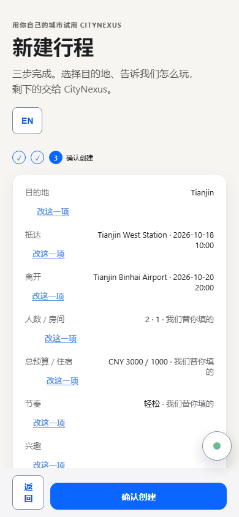
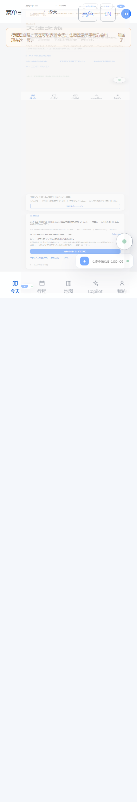
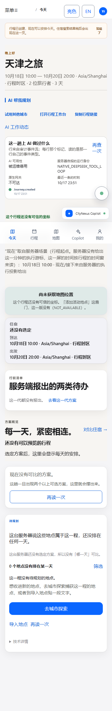
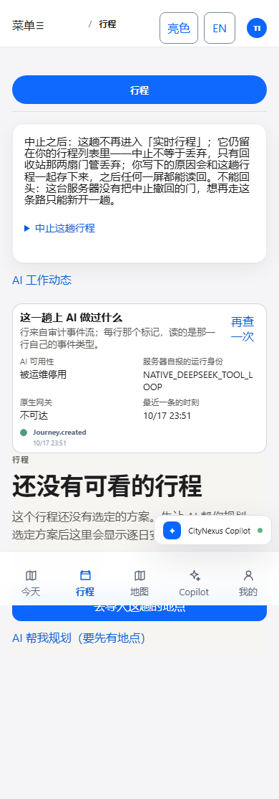

# CityNexus 第一次出行：真人走一遍（图文版）

这份教程的每张图都是**这台机器上真跑出来的屏幕**，不是设计稿：
由 `frontend/e2e/qoder31-signed-session.spec.ts` 在 390×844（手机档）驱动真前端 + 真后端
（`frontend/playwright.qoder31-session.config.ts` 起的一对服务），把每一屏截在
`frontend/docs/assets/`。跑法在文末「这些图是怎么来的」。

对应工单：Issue #31（A 真实身份 / B 建完就能用 / C 看得见 AI 在做什么）。

---

## 第 1 步：说一个城市，说你怎么到那儿



打开应用就是这一屏。只需要三件事：**去哪儿、从哪进、从哪出**。
日期默认给的是"明天起两晚"，人数与预算也有默认值——先别管它们，往下走就行。

要点：

- 城市名要用服务器词表里有的写法（屏下方「支持的城市」那一栏会告诉你哪些写法认得）。
  认不得时会当场说"没找到"并给出原因，不会让你按下去没反应。
- 「下一步」走两下就到确认页；确认页每一行后面都有「改这一项」，跳回对应那一格。

## 第 2 步：按「确认创建」，直接落到「今天」



这一屏是 Issue #31 B 要修的事：**行程一写进服务器，"今天"就交到你手上**。
住宿（可选的）搜索在背后继续跑，它跑到哪一步都只影响"今天"页上那一格的状态：
搜索中 / 没找到 / 失败（失败会给你一颗「再查一次」）。它不再把你扣在一个转圈上。

顶部那条提示说的就是这件事：*"行程已创建，现在可以安排今天。住宿搜索结果稍后会出现在这一页。"*

顺带两件已经生效的事：

1. 这一趟是**你这个签名旅行者**的：创建时服务器给这个标签页签发了一枚短期会话（只存在这个标签页的
   `sessionStorage` 里，不落 `localStorage`、不进 URL、不进日志），之后每一次读都带着它。
2. 同一台手机换人不换行程：设备里那枚"上次看到的行程"指针**不再是通行证**。
   服务器按签名判归属，不是你的行程就回 `JOURNEY_POINTER_NOT_OURS`，页面会把那枚指针和
   属于上一位的 AI 记录一起擦掉——而**不会**把你登出（错的是上一位留下的指针，不是你）。

## 第 3 步：看 AI 到底做了什么——「AI 工作动态」



「今天」页在 `AI 帮我规划 / 试用其他城市 / 打开行程工作台 / 复制行程链接` 那一排下面，
多了一颗 **「AI 工作动态」**。点开就是图里这块：

| 屏上那一格 | 它读的是服务器的什么 |
| --- | --- |
| AI 可用性 | `GET /api/v1/agent/runtime-status` 的 `ai_state`。图里这台机器上它是 `DISABLED_BY_OPS`（被运维停用），因为这台跑测试的后端启动时关了 AI 开关——**屏上没有替它编一个"正在工作"** |
| 服务器自报的运行身份 | 同一份答案里的 `runtime_identity`（图里是 `NATIVE_DEEPSEEK_TOOL_LOOP`） |
| 原生网关 | `hermes_native_gateway.reachable` → 可达 / 不可达 |
| 最近一条的时刻 | 事件流里最后一条的时间，按行程时区渲染 |
| 下面那一行行的轨迹 | `GET /api/v1/journeys/{id}/agent-feed`（服务器的审计事件流），每行的标记只按**那一行自己的事件类型**判（`requested/started` 才算进行中，`failed/refused` 才算失败） |

服务器回 0 条事件时，这块老实写"这一趟还没有 AI 工作记录"，并告诉你去问一句就会落第一条；
读不到时走的是全应用同一套失败归属（说清是谁拒的、拒在哪一层），并留一颗真的「再查一次」。

## 第 4 步：行程页上也有同一颗入口，而且它在整份行程之上



底部导航「行程」这一屏，入口排在**中止面板之下、整份行程之上**——
需要点开的东西不该先让你滚过整页。图里这一趟还没有选定方案，所以行程那一格写的是
"还没有可看的行程"，而 AI 工作动态照常给出这一趟真实发生过的第一条：`Journey.created`。

---

## 这一版还做不到的（不粉饰）

1. **事件行现在显示的是服务器写的事件类型**（如 `Journey.created`），因为审计表里那行的
   `summary` 是空的。面板不会替它编一句人话，但人话本来就该由服务器写——这是下一张单。
2. **可选住宿真有结果时，「AI 帮我规划」抽屉会自动打开**，它的遮罩会盖住"今天"整屏，
   包括这颗新入口（用例里必须先合上它才点得到）。这条自动打开是别人钉着的基线
   （`e2e/qoder-ai-sheet-blocked.spec.ts` 里两处 `plan-ai-sheet` 断言），我没有擅自改掉，
   但它和"建完就能操作今天"确实冲突，要主人点头才能换。
3. **右下角悬浮的「CityNexus Copilot」药丸会压在面板右下沿**（第 4 步那张图上看得见），
   属于固定底栏/浮层那一族的老问题（ORD-0406 同族）。
4. **签名会话默认 15 分钟到期，而这条线上还没有"重新登录／找回我的行程"那道门**：
   凭证一死，我们把令牌、行程指针与 AI 记录一起擦（不给泄漏留缝），代价是这个人要重新走一遍创建。
5. 这份教程的图来自**测试用的干净部署**（AI 关闭、库是本次新建的）。共享预览上的画面会更"满"，
   但每一格的判据与来源是同一套代码。

## 这些图是怎么来的

```bash
cd frontend
CITYNEXUS_PYTHON=<能跑后端的那个 3.12 venv 的 python> \
  npx playwright test --config playwright.qoder31-session.config.ts
```

这条命令自己起一对服务（前端 `:8131`、后端 `:8031`，`reuseExistingServer=false`），
在配置加载时现生成一次性签名密钥（值只进子进程环境，不写文件、不打印），
用一台 390×844 的手机档走完：建人 → 建行程 → 今天 → AI 工作动态 → 行程页 → 换人 → 无效凭证 → 匿名反控。
八臂全绿时的现读：`8 passed (39.7s)`；截图落在 `frontend/docs/assets/`。
