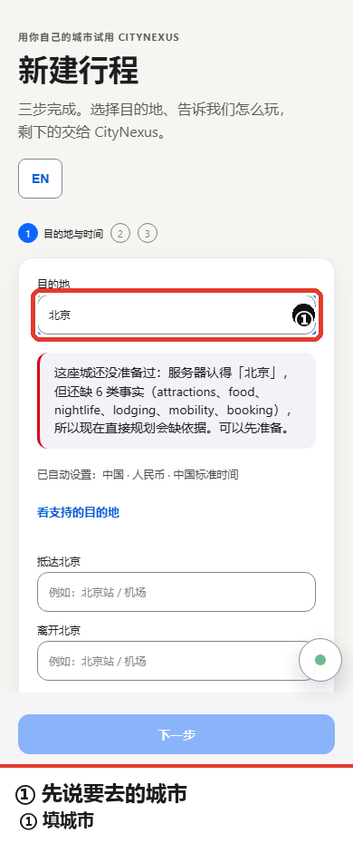
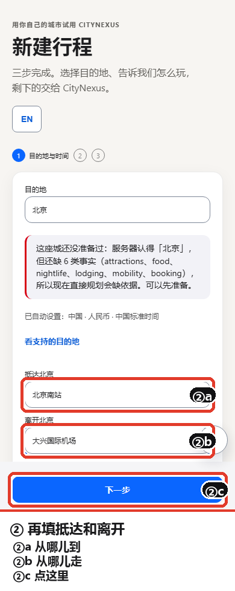
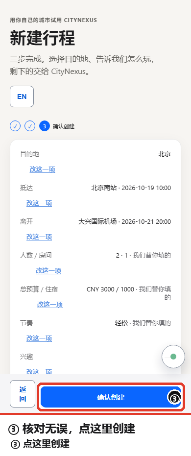
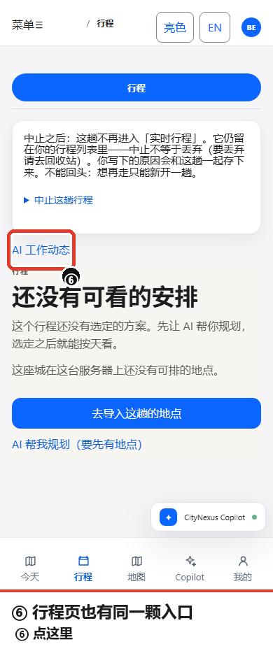
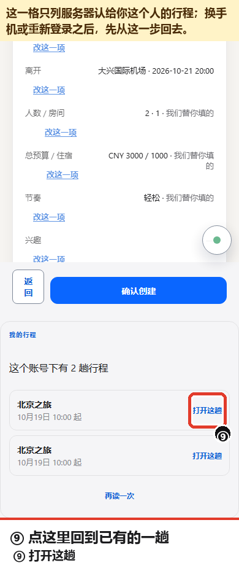

# 第一次用 CityNexus：跟着这九张图走一遍

这篇只讲一件事：你打开手机浏览器，从零开始建一趟行程，屏幕上会出现什么、你点哪里。
建完之后想回到已经有的一趟，看第 ⑨ 张。
所有图来自同一份代码、真后端、390×844 的手机画面，一次跑出来直接截的。
图上的红框和编号就是告诉你"这一步点这个"。

> 现在这台是测试环境，AI 那一路没打开。凡是 AI 该说话的地方，屏上会照实写"没有"（第 ⑤ 张就是这样）。

---

## ① 先说要去的城市



在圈出来的那一格里填城市名，比如「北京」。**这一屏没有要你点的按钮**：
「下一步」要等这一页的三格都填完才会亮起来（第 ② 张就是它亮了的样子）。

填完城市，输入框下面会自动出现一段服务器自己的话：它认不认识这座城市、手上还缺哪些地点。这段话不是报错。

---

## ② 再填抵达和离开



两格都要填：你什么时候**到**（a）、什么时候**走**（b）。填完点「下一步」（c）。

写"北京南站"这种大家叫得出的名字就行，不用写地址。

---

## ③ 核对一眼，点创建



这一页把你前面填的东西列出来，旁边写着哪些是我们替你估的（比如人数、预算）。

觉得不对就点那行的「改这一项」；没问题就点 **a**「确认创建」。

---

## ④ 建完就在这页，不用你去找


创建完直接落在「今天」这一页：上面是这趟的日期、时区、几个人、几天，中间是能直接点的动作。

**a** 就是「AI 工作动态」，今天页上一直有它。

顶部那条橙色提示说的是住宿搜索还在路上，等它回来结果会出现在这一页下方——它不影响你现在看这页。

---

## ⑤ 这一格只写服务器确证过的事


点开「AI 工作动态」，上半是 **AI 与工具真的做过的事**，下半是 **行程系统自己的动态**。

现在这台环境 AI 没开，所以上半照实写着「暂无真实运行」。

想核对某一行的技术细节，面板最下面有个「技术细节」，机器码收在那里，不占正文。

---

## ⑥ 行程页上也有同一颗入口



底部导航切到「行程」，同一颗「AI 工作动态」也在这一页，位置在标签下面。

今天页和行程页看到的是同一份东西，不是两个各说各话的列表。

这一页还会照实告诉你两件事：这趟**还没有选定的方案**，以及这座城在服务器上**有多少个可排的地点**。
地点是零的时候，它会直接给你一颗「去导入这趟的地点」，那才是下一步。

---

## ⑦ 觉得信息旧了，点这里再查


面板里的「再查一次」是向服务器重新要一遍，不是把刚才那屏重画。

数据什么时候是新的，面板上会写它自己那次读到的时间。

---

## ⑧ 查不到东西的时候，屏上有出口


住宿没查到，这一页会照实说「住宿搜索失败了，行程本身还在」，并给你一颗能点的**再查一次**（a）。

你的行程不会因为它没查到东西就没了。等不及也可以直接点「AI 帮我规划」，那条路不依赖住宿结果。

---

## ⑨ 换人、掉登录之后：从这一格回到已有的一趟



如果这台服务器认得你（这一页拿着你的登录凭据），新建那一屏的下面就有**我的行程**这一格：
它列的是服务器认给你这个人的行程（第 ⑨ 张里是两趟），点每行右边的**打开这趟**（a）就直接进去，
不用为了回到旧行程再新建一趟。

两件事：

- **名单只跟着登录凭据走。** 换了人、或者这台部署没开登录，这一格整块不出现。
- **过期之后这里不写"重新登录"。** 这台没有密码，屏上说的是「登录已结束。新开一趟就能回来」。

登录还在有效期内时，这一页会自己去把时间往前滑一格，你不需要点任何东西；滑不动了才告诉你上面那句话。

---

## 走通之后

「今天」这一页上，你马上能点的是这几颗（第 ④ 张里都在）：**AI 帮我规划**、**试用其他城市**、
**打开行程工作台**、**复制行程链接**，加上这篇讲的 **AI 工作动态**。

行程本身要中止，在「行程」那一页往下走有一块「中止这趟行程」，它会先告诉你中止之后
这趟去了哪里，再让你确认。

---

## 附录：这些图是怎么来的（给要复现的人，不给读者看）

**图不是手 P 的。** 三步就能在同一台机器上重出一模一样的八张：

```bash
# 1) 现起一台一次性后端 + 真 Chromium 390x844，逐屏截图并记下每个要圈的按钮的位置
cd frontend
CITYNEXUS_PYTHON=<这台机器的后端 python> \
  node node_modules/@playwright/test/cli.js test \
  --config playwright.qoder31-session.config.ts e2e/qoder31-first-trip-guide.spec.ts

# 2) 按清单把红框、编号、图下说明画到原图上
python scripts/annotate_first_trip_guide_r1.py

# 3) 产物：docs/assets/raw/ 是原图，docs/assets/0X-*.png 是本文引用的标注版
```

要点，都是被真实缺陷逼出来的：

- 坐标一律来自 `locator.boundingBox()`，连同当时的视口宽一起记进
  `docs/assets/manifest.json`；标注脚本按「PNG 实际宽 ÷ 记录时的视口宽」缩放，所以设备像素比
  变了也不会画歪。没有人手写坐标。
- 每个被圈的目标在截图那一刻都要过一道渲染闸：祖先的入场动画必须已经放完、自己不能是
  `visibility: hidden`、必须真的写着字。上一版有一张图截在 `.v8-page-intro` 淡入中途
  （实测 opacity 0.66），看着就是半张白屏——那道闸现在专门拦这个。
- 截图前等这一屏的 `document.getAnimations()` 全部结束，再留一点余量：读者点下去的时候，
  动画早放完了。
- 编号只写在贴着按钮的小角标里，动作话写在图片下方的说明带（同一张 PNG 内）。屏幕内容
  一个像素都不遮——上一版的悬浮黑条盖住了「动态」两个字和「住宿搜索失败」那一行。
- 截图取的是视口，`boundingBox()` 给的是文档坐标，两者只有在"这一格已经在视口里"的时候才
  对得上。第 ⑨ 张第一版就是栽在这里：那一格在屏幕下方 y=860 起，圈的位置量到了、画出来却
  是空的一屏。现在拍之前先把它滚进视口（`scrollIntoView({block:"start"})`）再等半秒。
- 说明带与顶部提示带都按画布宽度折行。同一张 ⑨ 的标题比屏幕长，右半边被裁过（"从这一格回"
  后面没了）；原先八张只是恰好没超过宽度，那不是机制。
- 文件名一律 ASCII：CJK 文件名在这台机器上撞过车，两张图互相覆盖，教程就会指到错的屏。

**正文里不出现的名字，放在这里。** 「AI 工作动态」那颗入口是
`src/features/agent/AgentWorkFeedPanel.tsx` 里的 `AgentWorkEntry`（今天页 testid
`hub-ai-work`，行程页 `trip-ai-work`）；面板分「AI 与工具真的做过的事」和「行程系统自己的动态」
两列，判据是那一行自己带的事件类型，词表在 `src/i18n/agentWorkFeedCopy.ts`。
第 ⑧ 张的失败态由用例把 `stay-options/generate` 这一条打到 503 产生，其余请求全部走真后端。
第 ⑨ 张那一格是 `src/features/trip/MyTripsEntry.tsx`：名单来自带登录凭据的
`GET /api/v1/journeys`（服务器只答这张凭据说得上话的行程），点「打开这趟」写的是壳里那枚
`citynexus.v8.journey_id`；这一格在没有凭据时整块不渲染。它由本用例自己拍——走到第 ⑧ 张
这一步时，这一台已经签过会话并建过两趟，所以名单里是两行。
