# 用 CityNexus 开始一次两站散步

本机新版入口：[打开绿色探索页](http://127.0.0.1:14332/revolution)。电脑上的启动终端需要保持运行。

下面用宁波的真实公开地点演示。红框和数字标出页面控件，每张图下都有未标注原图链接；手机上向上滑动就能看到页面下方的操作。

## 1．输入想去的地区

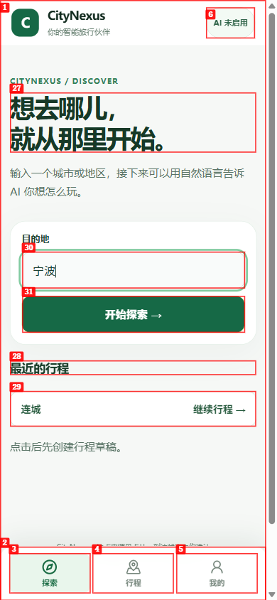

在“目的地”输入地区，点击 **开始探索 →**（红框 31）。这一步会创建你的探索草稿，已有行程可以从“最近的行程”打开。

[查看原图](results/assets/chrome-use-20261018/guide/guide-01-welcome-original.png)

## 2．查找这个地区的位置

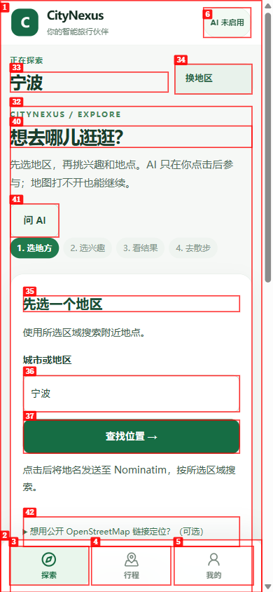

点击 **查找位置 →**（红框 37），页面会把地名发送给按钮下方说明的地图服务。等待查询完成后再选择结果。

[查看原图](results/assets/chrome-use-20261018/guide/guide-02-city-original.png)

## 3．地名服务连不上时，还有下一步

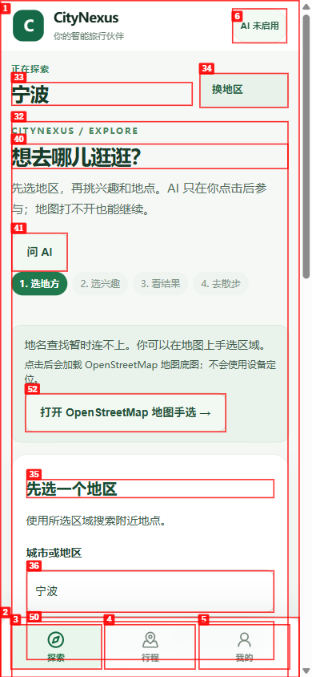

出现“地名查找暂时连不上”时，可以点击 **打开 OpenStreetMap 地图手选 →**。本教程使用下面的 Photon 备用查找路线，无需自己寻找地图网址或经纬度。

[查看原图](results/assets/chrome-use-20261018/guide/guide-03-failure-original.png)

## 4．使用备用地名查找

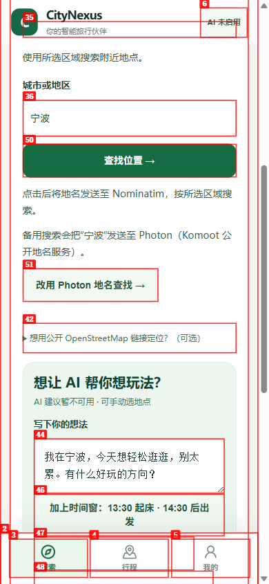

向下滑到 **改用 Photon 地名查找 →**（红框 51），阅读旁边的发送说明后点击。此次宁波查询通过这个入口返回了公开地区。

[查看原图](results/assets/chrome-use-20261018/guide/guide-04-photon-original.png)

## 5．选对城市

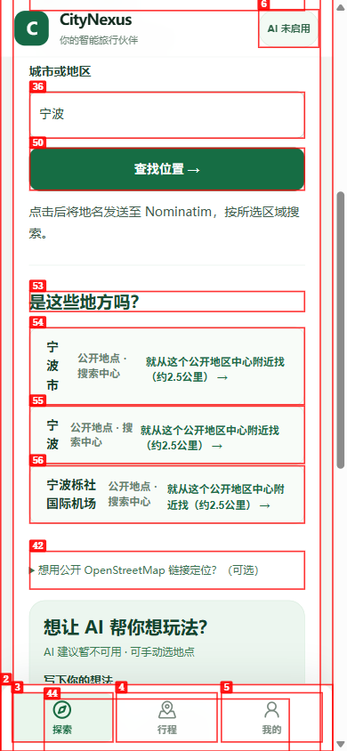

点击 **宁波市** 的地区卡片（红框 54）。同名火车站和机场也可能出现在结果里，请按自己的目的地选择。

[查看原图](results/assets/chrome-use-20261018/guide/guide-05-city-results-original.png)

## 6．从这片地区附近开始

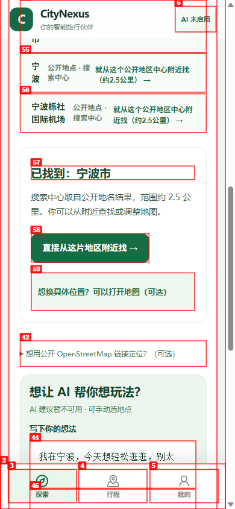

点击 **直接从这片地区附近找 →**（红框 58），进入兴趣选择。需要更具体的位置时，可以展开地图选项再调整。

[查看原图](results/assets/chrome-use-20261018/guide/guide-06-area-original.png)

## 7．选一个兴趣并搜索

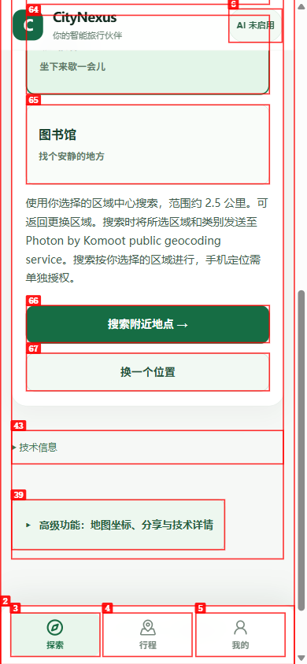

这里选择 **咖啡馆**，再点 **搜索附近地点 →**（红框 66）。按钮旁会说明本次搜索向哪个地点服务发送区域和类别。

[查看原图](results/assets/chrome-use-20261018/guide/guide-07-interest-original.png)

## 8．从真实结果里选两站

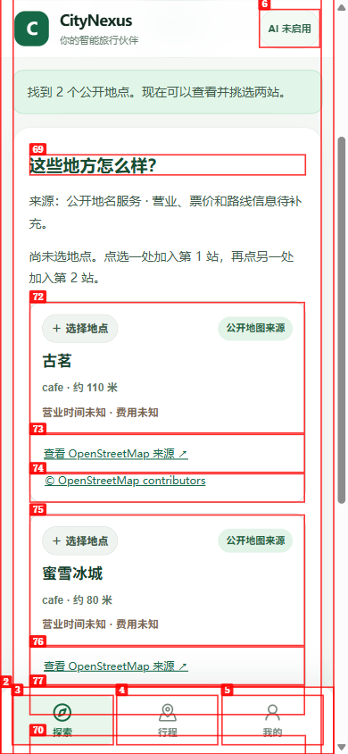

依次点击 **古茗** 和 **蜜雪冰城** 的地点卡片，卡片会显示“第一站”和“第二站”。想核对地点时，可以打开卡片上的 **查看 OpenStreetMap 来源 ↗**；营业时间和费用请出发前再确认。

[查看原图](results/assets/chrome-use-20261018/guide/guide-08-places-original.png)

## 9．保存这两站

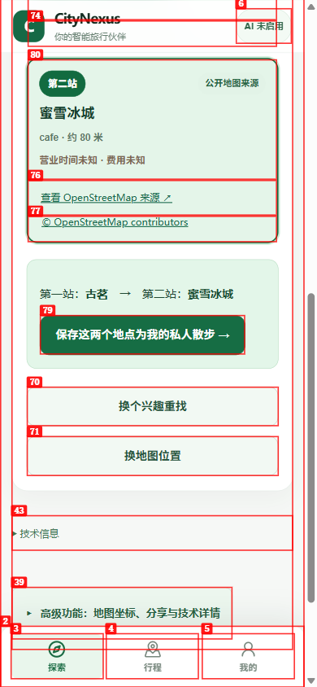

两站都选好后，点击 **保存这两个地点为我的私人散步 →**（红框 79）。页面出现已保存的两站后，就能开始散步。

[查看原图](results/assets/chrome-use-20261018/guide/guide-09-save-original.png)

## 10．开始 GO

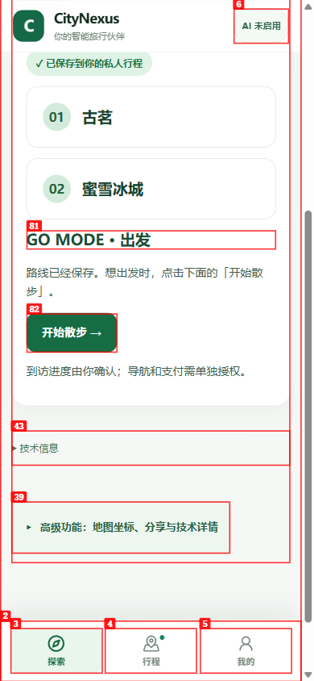

点击 **开始散步 →**（红框 82），页面进入“正前往第一站”。到达后再点对应的完成按钮，中途可以暂停和继续。

[查看原图](results/assets/chrome-use-20261018/guide/guide-10-go-original.png)

## 11．刷新后接着走

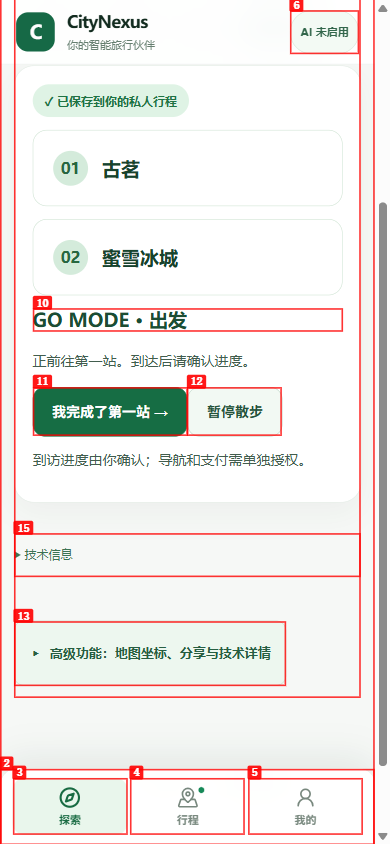

直接刷新页面，两站和“正前往第一站”的进度会恢复。请在同一浏览器中继续使用自己的行程。

[查看原图](results/assets/chrome-use-20261018/guide/guide-11-restored-original.png)

## 12．在“行程”查看路线和 AI 工作动态

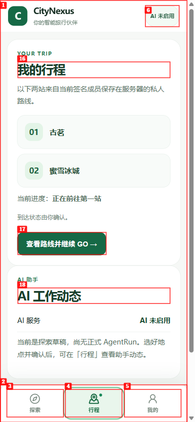

点击底部 **行程**（红框 4），这里有两站、当前进度和 **查看路线并继续 GO →**。下方 **AI 工作动态** 会显示实际服务状态；本机这次显示“AI 未启用”，正式 Agent 工作过程尚未可体验。

[查看原图](results/assets/chrome-use-20261018/guide/guide-12-trips-original.png)

## 13．在“我的”查看当前环境

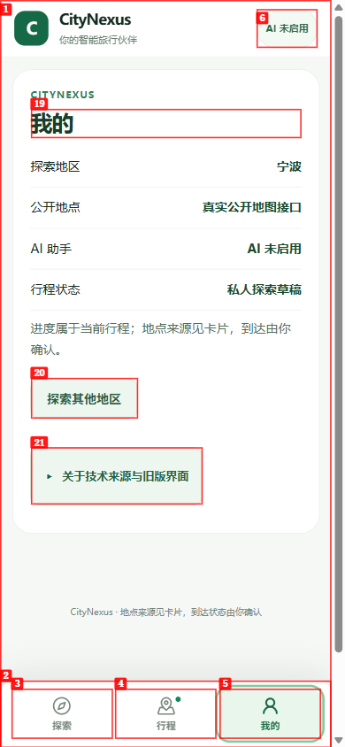

点击底部 **我的**（红框 5），可以查看当前地区、地点来源和 AI 状态。想开启另一趟探索时，点击 **探索其他地区**。

[查看原图](results/assets/chrome-use-20261018/guide/guide-13-me-original.png)

## 本机启动

已有入口打不开时，在当前分支的工作目录里运行：

```powershell
py -3.13 trial\try_revolution.py --fresh --frontend-port 14332 --backend-port 18501
```

如果提示端口已占用，先使用已经运行的入口；需要另开一套时换一组空闲端口。启动器会在本机询问地图服务联系邮箱，输入后按页面逐次确认查询。

这组图片拍摄于 2026-10-18，来自产品提交 `f23eae768c7ddb5ed4cdc96e38e17e65f4eeec7c` 的 Chrome-use 390×844 实际页面；公开地点、保存、GO 和刷新使用真实隔离后端。实际 Android/iPhone 操作与正式 ACTIVE AgentRun 继续单独验收，详细记录见 [本次中文实测报告](results/20261018_CHROME_USE_C0_C1_RESULT.md)。
