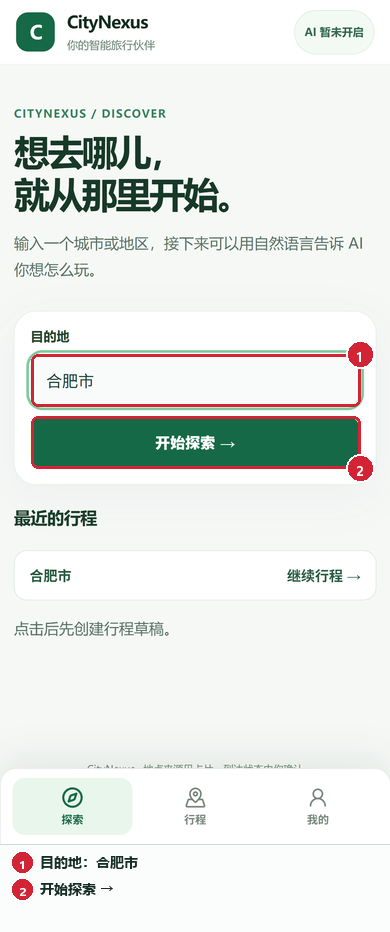
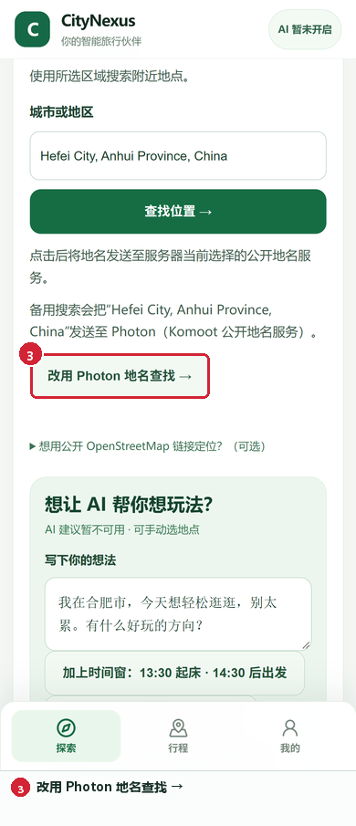
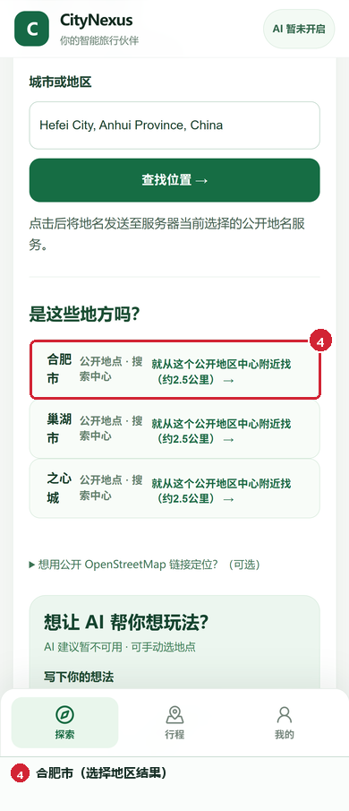
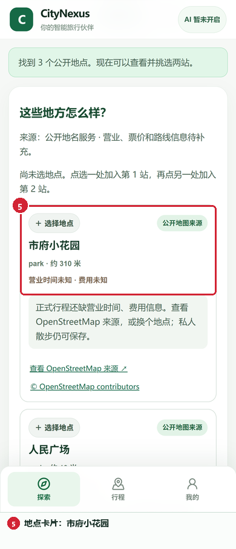
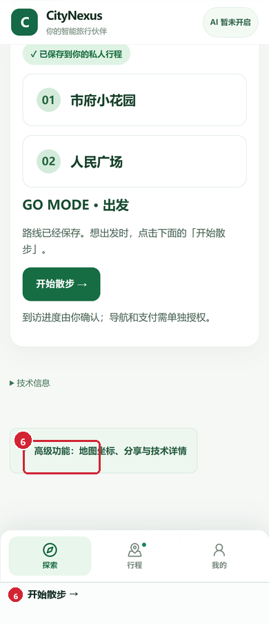
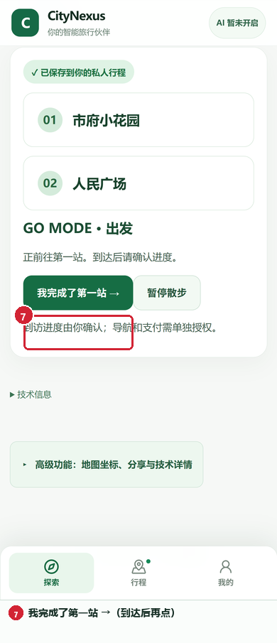
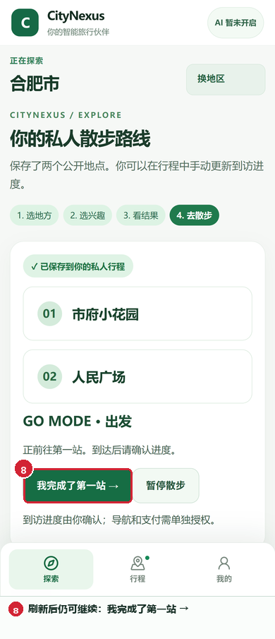
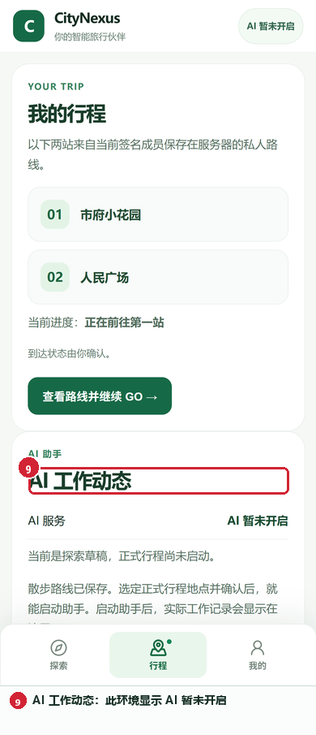
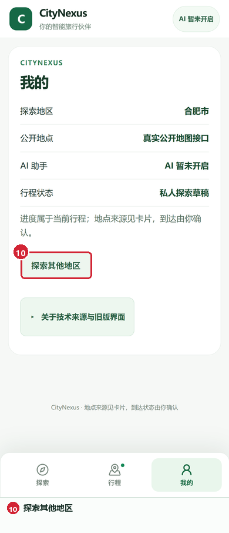

# 用 CityNexus 开始一次两站散步

打开 [Revolution 手机版入口](http://127.0.0.1:14332/revolution)，输入目的地后按页面步骤操作。下面这次用合肥举例；地图查询会在每次发送前显示服务名称和发送内容。

本教程来自 PR #23 产品提交 `1dbaa828872543112c9db2457f2c3ab6b54a6058`，由 Chrome-use headed Chrome 在 390×844 手机视口实测。每张标注图保留一份未标注 390×844 原图；标注版下方的编号对应按钮原文。

最新路线复核见[2026-10-18 C1 记录](results/20261018_ISSUE33_C1_FINAL_SHA_RECHECK.md)，其原图单独标注为 `f8f7e9d`，不与本教程的旧版标注截图混用。

## 1. 输入目的地并开始探索

在“目的地”输入 **合肥市**，点击 **开始探索 →**。页面建立个人探索草稿，进入地区查找。

[查看 390×844 原图](results/assets/illustrated-revolution-first-trip/raw/final-00-home-hefei-1dbaa-390x844.png)

## 2. 地名查找不可用时切换备用服务

本次主地名服务没有返回结果。页面显示备用服务的名称和本次查询内容；点击 **改用 Photon 地名查找 →** 后，Photon 返回合肥候选。

[查看 390×844 原图](results/assets/illustrated-revolution-first-trip/raw/final-04-photon-fallback-1dbaa-390x844-visible.png)

## 3. 选择合肥并确认搜索区域

点击 **合肥市**。接着点 **直接从这片地区附近找 →**，确认搜索中心，然后选择 **公园和绿地**。

[查看 390×844 原图](results/assets/illustrated-revolution-first-trip/raw/final-05-city-results-1dbaa-390x844.png)

## 4. 搜索并挑选公开地点

点击 **搜索附近地点 →** 后，真实公开地图查询返回 3 个地点：**市府小花园、人民广场、李鸿章故居陈列馆**。地点卡片可打开 OpenStreetMap 来源；本次营业时间与费用没有公开依据，所以页面显示未知。

[查看 390×844 原图](results/assets/illustrated-revolution-first-trip/raw/final-08-live-pois-1dbaa-390x844.png)

## 5. 保存两站为私人散步

先后选择 **市府小花园** 和 **人民广场**，点击保存。页面会列出这两站和 **开始散步 →**。

[查看 390×844 原图](results/assets/illustrated-revolution-first-trip/raw/final-10-pocket-walk-saved-1dbaa-390x844.png)

## 6. 开始 GO

点击 **开始散步 →** 后，状态变为 **正前往第一站**。到达后再点 **我完成了第一站 →**；路上也可以暂停和继续。

[查看 390×844 原图](results/assets/illustrated-revolution-first-trip/raw/final-11-go-heading-first-1dbaa-390x844.png)

## 7. 刷新页面后继续

整页刷新后，**市府小花园 → 人民广场** 和 **正前往第一站** 都恢复了，仍可继续这趟散步。

[查看 390×844 原图](results/assets/illustrated-revolution-first-trip/raw/final-15-reload-restored-1dbaa-390x844.png)

## 8. 在“行程”查看路线和 AI 状态

点底部 **行程** 查看两站和当前进度。本次隔离环境显示 **AI 暂未开启**，正式行程助手没有启动。

[查看 390×844 原图](results/assets/illustrated-revolution-first-trip/raw/final-16-trips-ai-status-1dbaa-390x844.png)

## 9. 在“我的”开始另一片地区

点底部 **我的** 查看当前地区、地点来源和 AI 状态；点击 **探索其他地区** 开始下一趟。

[查看 390×844 原图](results/assets/illustrated-revolution-first-trip/raw/final-17-me-status-1dbaa-390x844.png)

## 本次验收结果

- 真实 Chrome 手机视口：390×844；本机前后端 health 均为 200。
- 真实路线：合肥地名查找 → Photon 备用结果 → 3 个公开地点 → 保存两站 → GO → 刷新恢复。
- 私人路线当前仍是探索草稿；没有正式 ACTIVE Journey 或 AgentRun，AI 状态为未开启。
- 操作记录、截图与服务端持久化状态见 [Issue #33 中文验收记录](results/20261018_ISSUE33_HEFEI_REAL_WALK_RESULT.md)。

所有截图原图与标注框的浏览器 CSS 坐标记录在 [`annotations.json`](results/assets/illustrated-revolution-first-trip/annotations.json)，可用 `py -3.13 trial\annotate_revolution_screenshots.py` 重生成标注图。
