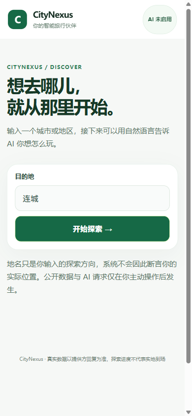
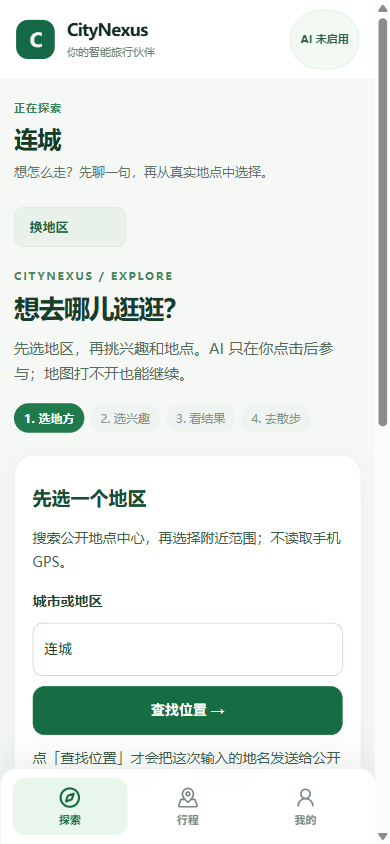
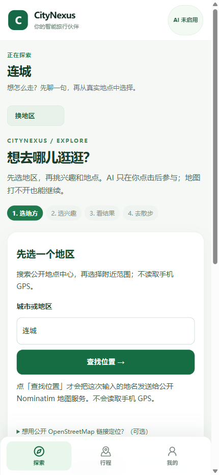
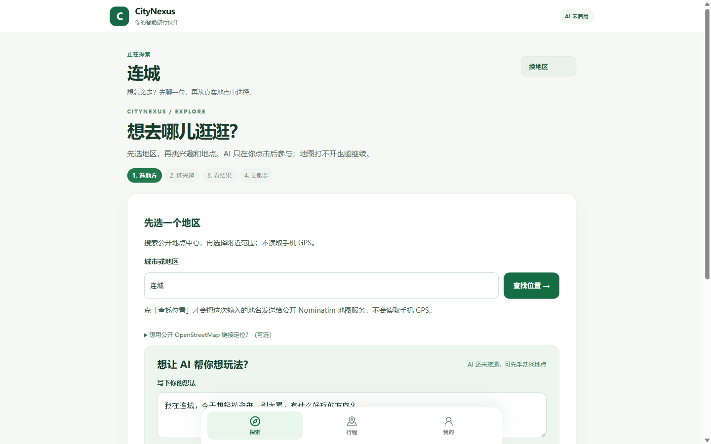
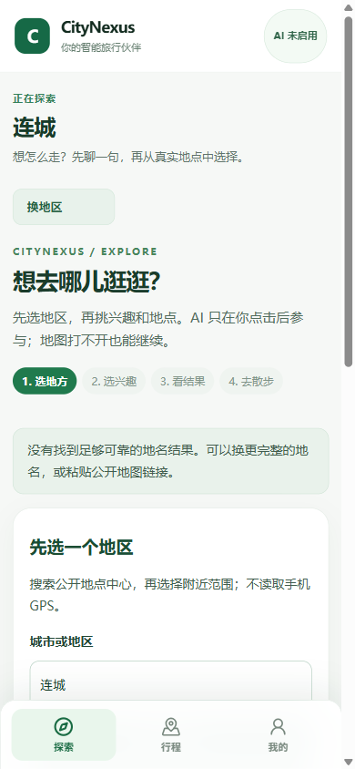
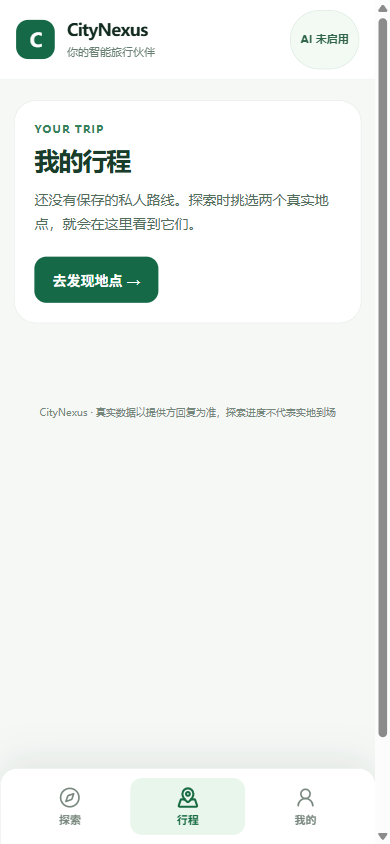
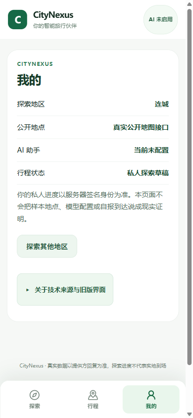
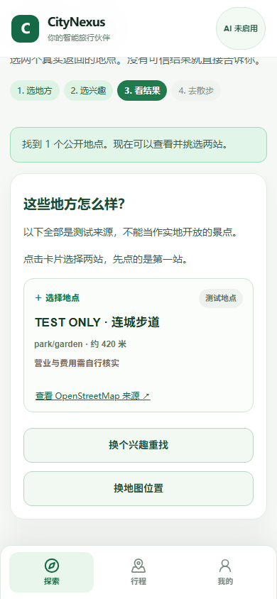

HUMAN_CAN_USE = PARTIAL

# Issue #21：手机优先版验收结果

本文件的 2026-10-16 记录保留为历史快照；最新情况见文末 2026-10-17 检查点。

截至 2026-10-16。分支：`design/revolution-mobile-first-v1`；PR #23 目标：`fix/revolution-first-human-e2e-20261015`（draft）。手机体验提交：`9fc03490a8b1043fe1b9ac9bfba14bc4fe46a39e`；地图轻触修复：`29cebe264a910cb7157b7b6036b03bc9cf2f3290`。

## 给普通用户的结论

Revolution 手机外壳包含「探索 / 行程 / 我的」三栏。探索页提供 AI 输入、地点来源信息和用户主动打开的地图；无可靠地点时可换地区或打开公开地图。

**验收状态：PARTIAL。** 隔离后端未启用实时地名与 Overpass，AI 运行时也未配置；真实地点搜索和“保存 Pocket Walk → GO → 刷新恢复”待验。R107/R108 后端接口回归 6/6 通过，地点来源为 `TEST_PROVIDER`。

## 这轮实际改了什么

- 调整了移动端城市输入高度和探索页顺序；点选搜索结果后进入地区确认，用户可使用近似地区中心或主动打开地图微调。
- 将探索页中的 AI 输入和地点卡片拆成 `MobileAiPrompt`、`DiscoveryPlaceCard` 两个组件。AI 按用户点击请求；当前未配置，按钮保持禁用，模型请求数为 0。
- 地点卡片显示来源状态、距离和营业/费用信息；来源链接限制为 OpenStreetMap；选地点按钮达到 44px 触摸高度。
- 地图瓦片需用户同意后加载；地图说明、不可用提示和标记颜色适配中文手机页面，主要触摸控件至少 44px。轻触地图会放点并进入兴趣步骤，地点搜索由用户提交。
- 修复地图首次轻触的真实运行时错误：此前首次创建 MapLibre 标记时先 `addTo`、后设置经纬度，会报 `Cannot read properties of undefined (reading 'lng')` 并中断进入兴趣步骤；现先设置坐标再挂载。失败追踪复现该错误，修复后单项与完整手机 Chromium 用例均通过。
- 新建本地 Journey 后，后续 POST 附带服务端签发的 traveler bearer；截图与报告只记录脱敏请求路径和状态码。

## 验收证据

| 项目 | 结果 | 实际情况 |
|---|---|---|
| TypeScript | 通过，`npm.cmd run typecheck:all`，退出码 0 | 本地隔离工作树 |
| Vite 生产构建 | 通过，`npm.cmd run build`，退出码 0 | 有体积警告：主 JS 约 1.86 MB，MapLibre 约 1.05 MB（未压缩） |
| Chromium 手机 UI | 6/6 通过，390×844、开启触摸模拟 | 其中地点与行程数据使用显式 `TEST_PROVIDER` fixture；地图瓦片请求在该用例中被拦截 |
| R107/R108 后端窄回归 | 6/6 通过，独立临时 SQLite | 覆盖私有 Pocket Walk 保存、回读、GO 状态转换和拒绝路径；地点来源为 TEST_PROVIDER |
| 本地真实后端浏览器连接 | 健康检查 200；创建 traveler 201；创建 Journey 201；带签名身份读取 bootstrap-shortlist 200 | 当前 Journey 保存路线数：0 |
| 实际地名搜索 | 页面显示“没有找到足够可靠的地名结果” | 隔离后端未启用实时 Nominatim / Overpass 来源 |
| AI / AgentRun | 待验 | AI 未配置；模型请求 0，成功 Run 0 |
| 真人手机与无障碍 | 待实测 | Android 键盘、底栏、地图手势、读屏和对比度 |
| GitHub CI | run `38868901954`（代码提交 `29cebe264a910cb7157b7b6036b03bc9cf2f3290`）通过：TypeScript、Vite build、Chromium UI smoke | 地点与行程数据使用 `TEST_PROVIDER` |

前端安装：`npm ci` 因 lockfile 缺少 `@types/react@19.3.0`、`@types/react-dom@19.3.0`、`csstype@3.2.3` 报 `EUSAGE`；验证使用 `npm install --no-save --package-lock=false`。

## 手机截图

真实本地隔离服务下的页面截图：

| Welcome 390×844 | Explore 390×844 |
|---|---|
|  |  |

| Explore 430×932 | Explore 1440×900 |
|---|---|
|  |  |

| 无可靠地名的恢复状态 390×844 | 行程页 390×844 |
|---|---|
|  |  |

| 我的 390×844 | 地点卡片 390×844（TEST_PROVIDER 数据） |
|---|---|
|  |  |

## 待验

1. 启用实时地名 / POI 来源后，完成签名浏览器搜索、保存、GO 和刷新恢复。
2. 配置 AI 后，由用户发起一次模型请求并验收 AgentRun 状态。
3. 在真实 Android 手机检查软键盘、底部导航遮挡、地图拖动与缩放，并做真人读屏与颜色对比复核。
4. 处理现有前端 lockfile 安装不一致，并评估代码分包以降低目前的 bundle 体积警告。
5. M1 下一步：将网络请求、身份和探索状态移入 hook/controller。

## 2026-10-17 检查点

- PR #23 当前提交：`f94d188a280e622008932349e2ac39afd73da7b5`，`trial-build` 正在运行。
- 首次进入时 Explore / Trips / Me 三栏都可用；空行程和“我的”页面能回到探索。切换栏位不会发送地点、AI 或支付请求。
- AI 状态查询期间显示“正在连接 AI…”，收到已配置响应后才开放 AI 建议按钮。
- `npm.cmd run typecheck:all`：通过。`playwright.mobile-trial.config.ts` 的两个 390×844 定向 UI 用例：2/2 通过，使用签名 UI fixture。
- 本机 wb2api 的签名 DRAFT 只读建议已真实返回，详见 `20261017_MOBILE_FIRST_P0_INCREMENT.md`。
- 两处真实地点 → Pocket Walk → GO → 刷新恢复仍待真实地点服务成功；持久化 ACTIVE Hermes `AgentRun` 与 Android 实机验收也待完成。
## 2026-10-17 本机 AI 实际调用

- 在手机 Explore 的签名 DRAFT 页面点击「问问 AI」，服务端 `trial-ai-discovery` 返回经过 schema 校验的真实模型工具建议：`MODEL_TOOL_SUGGESTION`，类别 `park/garden`，模型 `deepseek-v4.1-flash`。这是 DRAFT 只读建议，不创建 `AgentRun`，也没有查询真实 POI。
- 随后从本机教程读取 key 并直连 `127.0.0.1:7865/v1/chat/completions`，使用 `auto:cheapest` 发出一次受限工具调用：HTTP 200、`finish_reason=tool_calls`、1 次 `report_probe`，`usage.credit=0`，路由到 `global:deepseek-v4.1-flash`。请求 ID：`ef47b48a4e6d6f22ae5077f3241a9e4f`。
- key 未写入仓库、前端或报告；没有改动本机运行配置或数据库。
- 未完成：真实 POI 结果 → Pocket Walk → GO → 刷新恢复；ACTIVE Journey 的持久化 Hermes `AgentRun` 工具轨迹；Android 实机验收。
