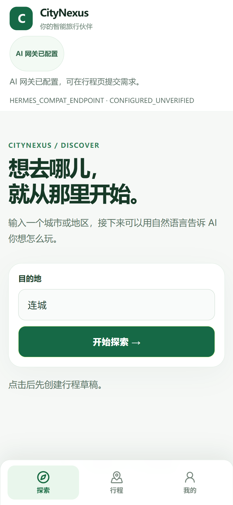
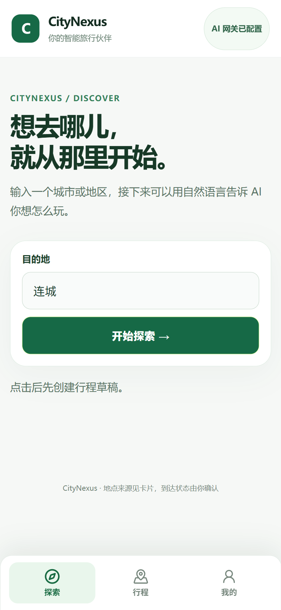
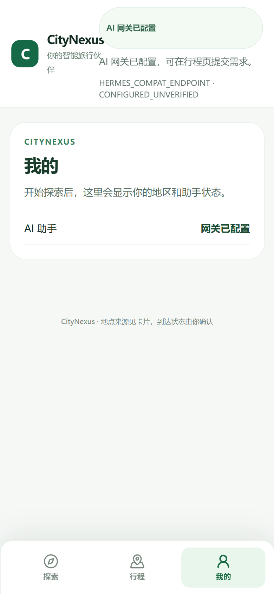

# Chrome-use 手机真人式复测

**日期：** 2026-10-17

**浏览器：** Chrome-use headed 独立测试档，手机视口 390×844，DPR 2

**首次复测页面：** `http://127.0.0.1:14173/revolution`

## 手动操作

1. 打开探索页，确认绿色首页、目的地输入框和底部三栏正常显示。
2. 点击“行程”再点击“我的”，确认两个页面可切换。
3. 展开“AI 网关已配置”状态卡。
4. 回到探索页，用键盘逐字输入“厦门”。
5. 在第二个干净 Chrome-use 会话重做状态卡展开，确认重叠可再次出现。

## 结果

- 通过：手机页面加载、三栏点击切换、键盘输入城市名。
- 发现：展开 AI 状态卡时，顶部状态内容盖住品牌标题和副标题；两个独立测试档都复现。
- AI 状态只显示网关配置状态，本次没有发送模型请求。
- 本次没有点击“开始探索”，也没有发起地点搜索、保存 Pocket Walk、GO 或刷新恢复。页面连接的是既有本机服务，服务对应的隔离数据库未核实；为避免写入常用数据，本次停在无写操作的浏览器交互。
- Chrome-use 会话没有启用 Console 捕获，本报告不提供 Console 结论。
- 该服务没有绑定到本分支的已核实构建号；截图证明该页面上的交互与布局现象，不证明某个提交的部署状态。

## 隔离 Chromium 夹具回归

PR 既有 `trial-build` 在 94e1b146 上有 7 个手机夹具用例失败：测试只启动 Vite，签名会话/行程恢复请求被转发到空的 `127.0.0.1:8000`。本次在手机 UI spec 中补齐签名会话与 ACTIVE Journey 读取响应，并为未播种 API 加入 404 夹具挡板。

命令：`$env:CITYNEXUS_MOBILE_UI_PORT='14573'; npm.cmd exec -- playwright test --config playwright.mobile-trial.config.ts --reporter=line --output C:\Users\仓鼠王\AppData\Local\Temp\citynexus-mobile-ui-ci-retest-20261017-isolated`
结果：12 passed，17.1 秒；视口 390×844，TEST_FIXTURE 数据，无真实地点服务、模型调用或 AgentRun。GitHub Actions 的 `trial-build` 在提交 `a4a8663d1b9c480cc74fead1eabe972314e77d54` 上通过：[run 39021241474](https://github.com/Canshu-King/CityNexus/actions/runs/39021241474)。

## 顶部布局修复后复测

在当前 PR 工作树的 Vite 页面 `http://127.0.0.1:14574/revolution` 再开一个 Chrome-use 干净 headed 测试档，设置 390×844、DPR 2。AI 状态接口由 Chrome-use 网络拦截返回 `HERMES_COMPAT_ENDPOINT / CONFIGURED_UNVERIFIED`；这个值只用于展示布局。

- CSS 改为手机窄屏下品牌与 AI 状态上下排列，展开说明允许随屏宽换行。
- 再次点击“探索 / 行程 / 我的”，三栏均切换成功；用真实键盘输入“厦门”，输入框值更新。
- 展开 AI 状态卡后，品牌标题、副标题和状态说明各自占行，没有重叠。网络记录只有一条被拦截的 `GET /api/v1/agent/runtime-status`；没有地点、行程写入或模型请求。
- 首次安装拦截规则前，浏览器曾向隔离占位端口 `18501` 请求两次状态读取，均因没有服务监听而连接失败；之后重载命中模拟响应。

修复后截图：

## 截图

绿色探索首页：

展开 AI 状态后的重叠：

