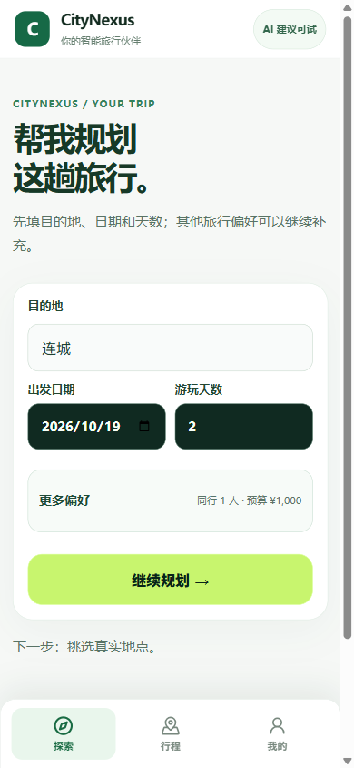

# AI 旅行规划启动入口

2026-10-18，本机已成功打开带 AI 配置的手机首页。用户提交需求后才会调用模型。

## 用户入口

- 双击 `trial/OPEN_REVOLUTION_AI.cmd`，直接启动 AI 旅行规划。
- 双击 `trial/OPEN_REVOLUTION.cmd`，选择 AI 旅行规划或仅探索。
- 命令行：`powershell -File trial/start_revolution.ps1 -Agent`。
- 使用已有本机 wb2api，模型选择为 `auto:cheapest`。密钥通过进程环境或隐藏输入读取。
- 启动器核对已有实例的工作目录及 AI 模式，避免选择 AI 后打开 AI 已关闭的旧实例。

每次新实例的数据库和日志放在本机 AppData/CityNexus/Revolution 的独立目录，复用本工作树已有 Python 环境。既有试用数据保留。

## 实际检查

检查基线为 `7cff85b6b03f652b2aa61978ef0d4c0d16226520` 加本次启动器改动。

- Windows PowerShell 实际启动 `-Agent -NoBrowser` 成功；前端 14332、后端 18501 健康检查均为 HTTP 200。
- 服务端 runtime-status：`HERMES_COMPAT_ENDPOINT`、`hermes_compat_configured=true`、`CONFIGURED_UNVERIFIED`。
- Chrome-use 390×844 打开 `/revolution`，首页显示「AI 建议可试」，可见目的地、日期、天数和「继续规划」。
- `-CheckOnly -Agent` 找到本工作树对应的 AI 实例，退出 0；`-CheckOnly -Mode Explore` 不复用该 AI 实例，退出 2。
- Python AST 和 PowerShell AST 检查通过；wb2api 配置单测 4/4 通过，无网络请求。
- 本轮没有提交模型需求、地点搜索或创建行程；真实 AgentRun 仍由后续正式行程流程验收。

