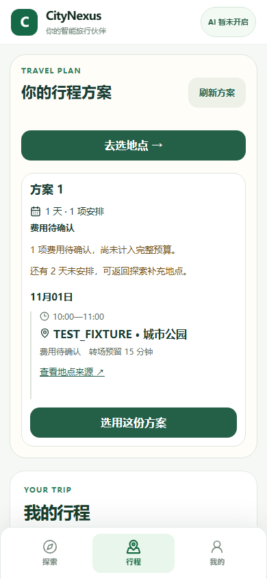
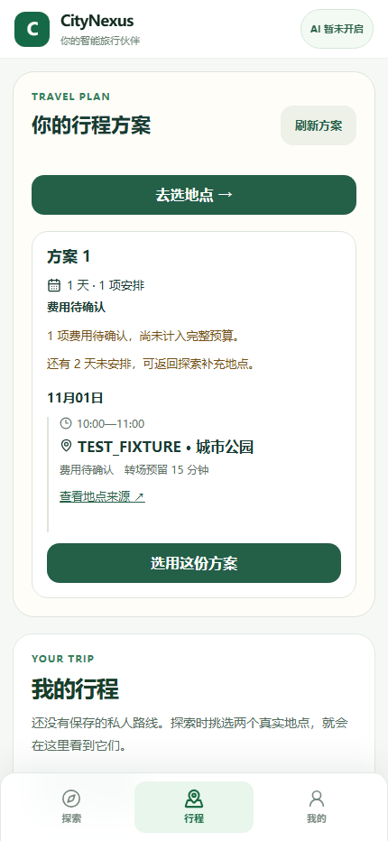

M1_PLAN_WORKBENCH = PARTIAL

# 手机行程方案预览与确认

本次继续 PR #23 的 M1，基线为 `ea5cf0d0396de805033829fa4da50a76ed06e030`。产品、测试和本报告在同一提交交付。

## 用户现在多了什么

- 「行程」读取当前签名用户的服务端方案，按当地日期显示活动、开始结束时间、费用、转场预留和已提供的地点来源。
- 生成方案、选用方案、确认启动是三个独立动作。生成之后先看内容；选用之后可刷新恢复；只有用户再次确认才请求正式启动。
- 需要三天但方案只覆盖一天时，页面显示剩余未安排的两天。未知费用不显示为免费。
- 有已核实地点时可明确确认未知门票费用后生成方案；没有可规划地点时提供返回探索入口。
- 方案列表在启用签名认证时验证成员的 `JOURNEY_READ` 权限，响应禁用缓存。切换 bearer 后，界面清除上一位用户的方案。

## 本次验证

- TypeScript `typecheck:all`：PASS。
- Vite build：PASS；仍有既有的大包体积提示。
- 后端 `tests/test_mobile_plan_workbench.py`：1/1 PASS。使用独立临时 SQLite 和签名测试身份，实际请求应用路由：匿名 401、外人 403、成员 200、撤销读取能力 403，成功响应 `no-store`。服务端方案是明确创建的 CANDIDATE 测试数据，未创建 ACTIVE 行程。
- Chromium 手机界面：390×844、430×932 两个用例 PASS。覆盖查看方案、单独选用、刷新恢复、单独启动、44px 触摸目标、无横向溢出，以及换身份后清除旧内容。网络由 `TEST_FIXTURE` 拦截；测试中的启动响应是夹具。
- 修复过程保留了两次失败：初次后端测试错误使用 frozen settings；初次界面测试发现复用执行页的方案读取缺少 bearer。两处修正后分别重跑通过。
- 本轮没有公网地点或模型请求，没有新增真实 PlanVersion / ACTIVE Journey / AgentRun 证据。

## 渲染截图（TEST_FIXTURE）

## 尚未完成

真实地点的营业等来源仍须满足原有正式规划条件。本次交付方案查看与确认能力，尚未把一条真实旅行需求连续走到多日 PlanVersion、ACTIVE 和真实 Hermes 工具执行；GitHub 最新 M1–M3 指示继续保持未完成。
