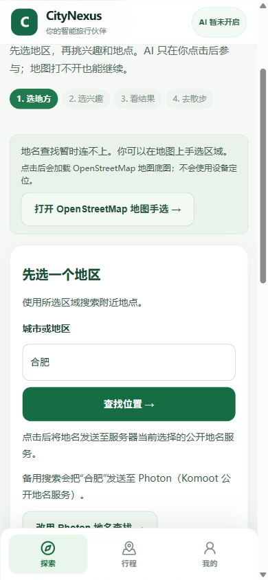
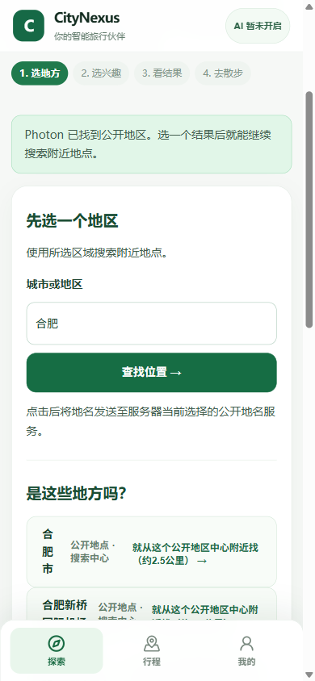
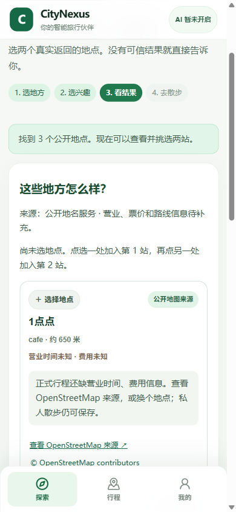
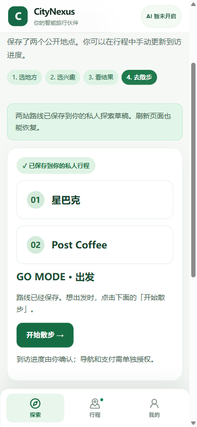
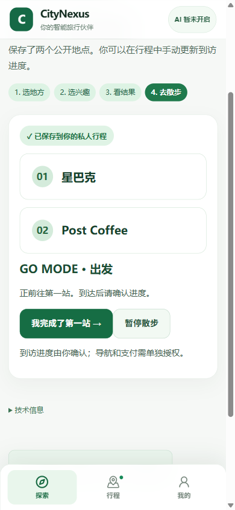

# PR #23｜Revolution C1 同会话实测

## 当前入口

- PR：[#23](https://github.com/Canshu-King/CityNexus/pull/23)
- 实测代码：`04beae7af14a2e2390fb02999d44b907960ed4d7`
- 后续 Hermes 错误文案改动：`bcc5be03963a9672ce32823bd490213b91e5fb78`
- 最终版同一数据库刷新复核：`bcc5be03963a9672ce32823bd490213b91e5fb78`
- 本机入口：<http://127.0.0.1:14332/revolution>（服务运行期间仅本机可用）
- 健康检查：HTTP 200，数据库 `ok`，AI `DISABLED_BY_OPS`
- 浏览器：Chrome-use 独立测试档案，390×844 视口；不是实体手机

## 一次完整路线

| 操作 | 实际结果 |
| --- | --- |
| 创建用户与行程草稿 | `POST /api/v1/travelers` 201；`POST /api/v1/journeys` 201；页面显示合肥探索 |
| Nominatim 地名查询 | 页面提示“地名查找暂时连不上”；本地 API 返回 200，但没有向页面提供外部 HTTP 状态；只请求一次，没有重试 |
| 点击 Photon 备用入口 | 页面披露会把“合肥”发送到 Photon；点击后本地 API 返回 200，显示“合肥市、合肥新桥国际机场、合肥南”，本人选了“合肥市” |
| 查询附近咖啡馆 | 页面披露会向 Photon 发送所选地区和类别；本地 API 返回 200，真实返回 3 个公开地图地点：1点点、星巴克、Post Coffee。隔离数据库记录 `provider_key=photon`、`source_provenance=LIVE_PROVIDER`；没有使用地点夹具 |
| 选择两站并保存 | 选择星巴克、Post Coffee；`POST .../bootstrap-discovery/pocket-walk` 返回 200，保存到私人散步 |
| 点击 GO | `POST .../bootstrap-shortlist/pocket-walk/go` 返回 200，界面显示“正前往第一站” |
| 整页刷新 | 页面与行程读取均返回 200；界面恢复两站和“正前往第一站”。数据库复核为 Pocket Walk 1 条、所选站点 2 个、进度 `HEADING_TO_FIRST`、修订号 1 |

本轮发现服务当前将真实地点检索配置为 Photon；没有发送 Overpass 请求。卡片上的营业时间与费用均为未知，所以这些地点只进入私人散步，没有被升级为正式计划。

## 验收结论

- `ONE_TAKE_REAL_POI_GO=YES`：同一个新签名 DRAFT、同一个隔离服务与数据库中完成 Photon 公开地点查询、两站保存、GO 和刷新恢复。
- `PERSISTED_AFTER_RELOAD=YES`：刷新后仍是同两站，数据库进度为 `HEADING_TO_FIRST`。
- `ACTIVE_JOURNEY=NO`：本次行程仍为 `DRAFT`。
- `REAL_AGENT_RUN=NO`：该行程没有 AgentRun。
- `USER_VERIFIED=PENDING`：这次由开发工具执行，等待用户本人试用。
- `PHONE_HARDWARE=NOT_TESTED`：本次是桌面 Chrome 的手机尺寸视口。

本机 WB2API 控制台的 `/v1/models` 返回 200，模型目录含 `auto:cheapest`。CityNexus 当前隔离后端仍报告 `AI_DISABLED_BY_OPS`；本轮没有发 Chat Completions 或 Hermes 工具调用。正式 Hermes 验收需要真正的 ACTIVE 行程，不能把本次 Pocket Walk 或 DRAFT 建成 ACTIVE。

## 页面截图

截图来自上述同一个 Chrome-use 会话。每个文件名对应当时的屏幕状态。

## 本轮代码验证

- Hermes 安全错误摘要后端窄测：2 passed。
- 手机 Hermes 失败轨迹 `TEST_FIXTURE` Chromium 用例：1 passed。
- 改为中文原因文案并隐藏内部错误码后，同一用例再次运行：1 passed。
- PR `trial-build` 在代码提交 `04beae7` 上通过：run [39092488593](https://github.com/Canshu-King/CityNexus/actions/runs/39092488593)；后续提交 `bcc5be0` 的 TypeScript、Vite build 与 Chromium smoke 也通过：run [39093514247](https://github.com/Canshu-King/CityNexus/actions/runs/39093514247)。
- 以上夹具只验证错误码到安全展示文案的映射，不代表真实 Hermes 运行。
