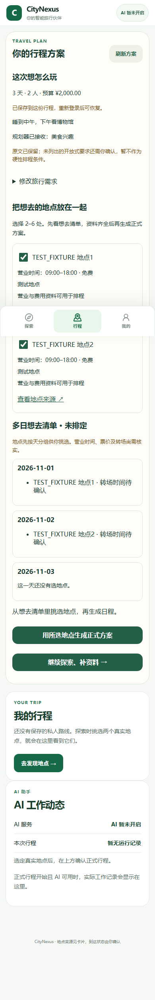
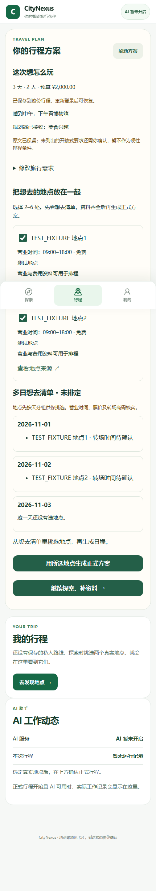

# 旅行需求进服务端与多地点方案增量

HUMAN_CAN_USE = PARTIAL。产品代码 `698b5eb23fb17dc6ffe0027636b8840167bee3f7` 已完成本地验证；当前真实试玩后端尚待正常重启到新版。

对应 PR #23 最新指示：[6247650836](https://github.com/Canshu-King/CityNexus/pull/23#issuecomment-6247650836)。

后续产品修正 `a0269f9f86`：在行程页保存需求后，同一页面的 AI 草稿同步到服务端回执中的需求；用户另行编辑的 AI 草稿不会被覆盖。390/430 定向用例2/2通过，新增检查期间修正了段落与 textarea 文本重复导致的测试定位歧义。

## 新产品与接口

1. `POST /api/v1/journeys` 接受可选 `planning_intent: {goal, interests, energy}`，与 Journey、OWNER 成员在同一事务保存到既有 `JourneyIntent`；含此字段时要求签名旅客与创建人一致。日期、人数、预算继续来自 Journey / JourneyTripContext。
2. `GET /api/v1/journeys/{id}/planning-intent`：签名成员读取本人的需求、本人有效地点观察及多日预览输入，`private, no-store`。重新认证后的另一浏览器可恢复，不读取设备 localStorage 的私人偏好作为正式输入。
3. `PUT /api/v1/journeys/{id}/planning-intent`：行程 OWNER 在 DRAFT 阶段编辑需求，更新原记录。手机行程页可直接修改原文、兴趣与节奏。
4. `POST /api/v1/journeys/{id}/plans/generate` 新增 `bootstrap_candidate_ids`，选择 2–6 个不同的本人有效地点，通过原来源门禁与 materialization 后，进入既有 `generate_plans` / generic composition。保留原 Idempotency-Key 回执，不新造排程模型。营业/费用不足会返回具名拒绝，未生成 PlanVersion。
5. `planning_preference_items` 读取这份持久意图，供既有 generic / authoritative 规划器消费；美食、户外、文化等明确兴趣进入分类匹配，“睡到中午”通过既有 day-rhythm 解析改变 generic 日窗口。PlanVersion 记录意图 ID、版本时间与摘要哈希，不把私人原文放入共享方案。

目前支持的映射会在页面显示。开放式原文完整保留；“海边”等尚未编译成可执行条件的要求不被暗中丢弃，也不声称已满足。少走路是软偏好，不代表已有经过核实的步行距离上限。人数、日期、预算从服务端读取；日期不足、未安排天数仍显示实际缺项。

## 手机体验

行程页集中显示来自多次本人搜索的地点，可多选查看按天分组的**想去清单（未排定）**。地点保留来源链接、营业、费用；转场未知直接显示未知。只有至少两处均通过原正式门禁才允许生成正式方案；选择方案、确认启动仍是两个独立动作。

以下为真实 Chromium 渲染截图，数据为明确的 **TEST_FIXTURE**，不是本次 live 来源或手机硬件证据：





## 实测状态

| 项目 | 本次结果 |
| --- | --- |
| 新需求接口 / 原生 PlanVersion | 独立 SQLite 签名测试通过；两处来源夹具经原接口补事实、选中、原生生成及读取；同 key 重发为同计划，新 key 可生成下一方案。不是 live POI 的连续证据。 |
| 偏好实际消费 | 美食改变原分类排序得分；中午起床使生成活动不早于12:00；条件下雨未伪装成当前天气。 |
| 真实来源 → 新版 PlanVersion | 本轮未完成；旧南京/台北已成功读取的来源仍缺营业/费用。 |
| 真实 ACTIVE | 本轮未发生。 |
| 真实模型 / 工具 / AgentRun | 本轮 Chrome-use 在现有签名DRAFT与真实后端明确提交一次新需求；CityNexus返回502，上游7865返回401，265ms。请求已发出，认证拒绝，模型执行及工具协议均未验证；没有AgentRun。未重试，未触发POI/保存/GO/付款。 |
| 验证 | 后端相关61/61；手机 Chromium 全套26/26；随后截图定向2/2；启动器4/4；TypeScript、Vite build通过。 |

本次首次全套 UI 发现旧测试的只读请求清单缺新 GET，更新断言及夹具后全套通过。初次后端组合测试复用了固定 OSM 身份导致跨用例城市冲突，改为每次独立的夹具身份后通过。两个问题都保留原来源门禁，没有放宽产品校验。Vite 仍有既存大分包提示。

真实AI请求前补充并核对页面披露：「点击后将文字发送给已连接的 AI 服务，可能产生模型费用。」原生Chrome-use点击无请求，在资源记录和后端日志确认后才同页DOM点击一次；脱敏结果见 [HTTP回执](20261018_BOUNDED_AI_HTTP_RECEIPT.json)。上游401只能证明认证被拒，尚未确认是密钥、网关配置还是其他认证条件，未将其写成已定位的密钥故障。

这次真实错误页面的390×844截图也尝试了一次，Chrome调试器 `Page.captureScreenshot` 在8000ms超时，未生成图片，未重试。本报告的两张新手机图因此仍明确标为TEST_FIXTURE；真实错误有浏览器响应与后端脱敏日志回执，没有假造截图。

随后仅做不调用模型的 `/v1/models` 认证检查：控制台配置文件的 `api_key` 值返回401，用户已提供教程中的客户端Key返回200/53模型。现已支持 `--wb2api-key-file` 显式读取用户指定的单行Key文件或教程API Key表格，优先于无关环境值，仅传入隔离进程内存。没有修改网关配置，也没有重发Chat Completions。

## 唯一当前运行操作阻塞与正常人工重启

当前试玩入口仍为 <http://127.0.0.1:14332/revolution>，后端18501仍运行旧代码。此前向启动会话46437发送正常停止换行被自动审批拒绝：`approval required by policy, but AskForApproval is set to Never`。本轮未重试、未换杀进程方式绕过，也未启动替代实例来冒充旧服务已升级。

正常操作：先在**原启动窗口按 Enter**停止该次试玩；然后在本分支目录运行下列命令。新参数 `--resume-database` 校验已有 DB 与相邻认证密钥，拒绝另建数据库、越出 runtime 目录或与 `--fresh` 混用。命令不会代替页面发起模型或地图查询；邮箱/本机 key 如需输入只在本机提示框完成。

```powershell
Set-Location 'D:\moodle\_codex_workers\citynexus-chromeuse-retest-ccdd7486-20261018'
$trialRun = 'C:\Users\仓鼠王\AppData\Local\Packages\OpenAI.Codex_2p2nqsd0c76g0\LocalCache\Local\CityNexus\Revolution\5e2ddbf81da2-20261018-144858-6da344'
& '.\backend\.venv\Scripts\python.exe' '.\trial\try_revolution.py' --agent --wb2api-key-file 'C:\Users\仓鼠王\Desktop\教程_本机项目接入网关_2026-10-14.md' --runtime-dir $trialRun --resume-database '_revolution_hands_on_20261018_144901.db' --frontend-port 14332 --backend-port 18501
```

重启后才继续新的明确地点名称查询与真实来源补证。新正式 PlanVersion → 用户选用 → 确认 ACTIVE → 一次有界模型/工具调用 → 服务端 AgentRun 的 live 连续验收仍是剩余项。
