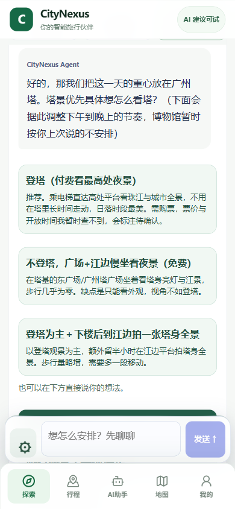

# Agent 对话与选择修复

产品：`05f858712b02a0fd10eba5bb194940b6e3b7708c`（主体 `4e3227f74e`）。

## 使用方式

普通“发送”先讨论：回答问题、提出旅行偏好取舍、给可点选选项。选择会作为回复进入同一个任务，也能直接输入自己的想法。对话直接展开，新回复自动滚入视野；原有聊天记录保留。

“按讨论的方向开始研究”是独立动作。讨论模式仅能读取本行程和向旅行者提问，不执行地点查询或日程写入；研究时仍可提出重要取舍。取消“研究工作量”选项和追加额度流程，新界面使用开放研究任务，累计模型轮数和工具次数不再使任务停下。已有用完旧额度的任务也可直接续聊。既有签名成员、来源同意、取消和错误恢复保留。

聊天输入改为短占位文字和随内容增高，默认没有挤出的滚动条；最新回复、选项和开始研究按钮避开底栏。

## 真实操作

通过 Chrome-use 原生填表/Enter，在原广州任务里说“先别查新地点、不要修改草案，先问偏好并给选择”。真实 WB2API 模型调用 `ask_traveler`，提出旅行风格问题并等待选择。点选“塔景优先”后，模型继续询问登塔、塔下休息或两者结合，再次等待回答。

- 同一个 task：`73a7efa7-0fb0-4e2a-bf8f-3001a3865600`。
- 两轮实际对话：模型用量 **8→10**，工具用量 **7→9**；旧模型上限为 8，新任务状态 `unlimited=true`。
- 两个新运行都只调用 `ask_traveler`；实际 ProviderCall **115→115**，没有新地点查询。
- 草案与三个备选逐字不变；当前状态 `NEEDS_DECISION`，保留三个真实模型选项。
- 390/430 实际 Chrome 截图，页面宽度与视口一致。真人手机触控待用户试用。

[结构化回执](20261019_AGENT_DISCUSSION_RECEIPT.json)

[430宽实际画面](assets/20261019-agent-discussion-real-430.png)

## 检查

后端聚焦 **29/29**；完整界面夹具 **48/48**，随后最终对话/选择/研究专项 **3/3**；TypeScript、Vite 通过。后端夹具验证：讨论不能调用研究工具；问题和选项可恢复；回复保留 task_id；开放任务实际越过旧的一轮/零工具上限继续执行。界面夹具检查普通发送、点选、显式开始研究、刷新历史、取消工作量选择和输入框自适应。

本机入口继续使用 `http://127.0.0.1:14332/revolution`，原库和认证保留。刷新后点击“对话”，可直接回答现有问题。
