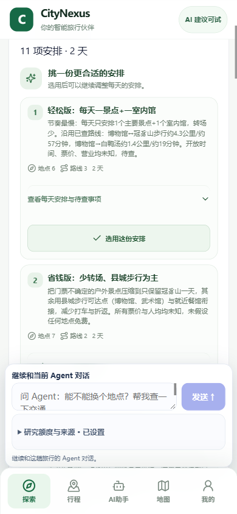

# 连城 Mission：三份备选、行程守护与统一输入

现在可以在同一旅行任务里让 Agent 比较多份两日草案，展开每天安排与待查事项，再选用其中一份继续修改。

## Agent 实际做了什么

在现有连城签名 DRAFT Mission 中，通过可见 Chrome 的 chrome-use 输入一条新要求：利用已有真实地点与步行路线保存轻松、省钱、特色三个备选，并读取当前守护记录；保留已选日程，不新增地图查询。

真实 run `4715479e-c9e9-4625-b3d7-626c25539e15`：

- 模型累计 43→46 轮，本次 3 轮；工具累计 40→42 次，本次 2 次。
- `read_guardian_stream` COMPLETED：读取当前 Journey 的已存记录。
- `save_draft_variants` COMPLETED：三个两日备选已存入同一个任务，签名 GET 200 恢复三份。
- 原日程保持第 6 版，前后 SHA256 同为 `9adcc621c65e3207a7bb40cd710f51446a5801f40cd1366e80e7154523e465f3`。
- ProviderCall 总数 73→73，没有新地图来源请求；备选复用此前实际查到的高德/OSM 地点与路线。模型请求使用现有本机 wb2api 配置。

| 备选 | 有来源的地点引用 | 已有路线引用 | 天数 |
| --- | ---: | ---: | ---: |
| 轻松 | 6 | 3 | 2 |
| 省钱 | 7 | 2 | 2 |
| 特色 | 6 | 1 | 2 |

费用、营业及未查询路段仍列为待查。省钱是研究策略，未知票价没有被改写为免费。

## 产品改进

- Mission 底部成为唯一自然语言输入；原探索页的 AI 快捷按钮指向同一个输入，旧表单不再出现。手动城市查找、POI、私人散步功能保留。
- 晚起、少走路和雨天偏好共用这一个输入，不会仅因点偏好或切换页面就发模型请求。
- 同一次来源/预算选择适用于该任务内连续研究。来源失败时实际运行状态保持 WORKING，避免尚在处理却显示“已结束”。
- 首次得到来源地点却只回复文字时，系统在剩余额度内提醒模型保存可编辑草案，不增加用户已选额度。
- 三个备选显示日期、来源/路线数量、待查项；选用复用既有签名草案保存，具有版本冲突检查，刷新恢复。
- “行程守护”按真实记录显示变化→影响→行动及当前恢复轮次。默认折叠；可手动刷新；ACTIVE 页面展开时每 10 秒只读刷新，读取失败后停止自动刷新。它不会因为打开卡片而启动守护任务。
- 修复保存旅行需求后 Mission 输入仍停在旧预填目标的问题；另行输入且未发送的文字保留。

## 当前守护结果

本次签名 GET 200 返回 WATCH_NOT_RUNNING，事件/影响/行动均为 0，epoch 为 null。界面显示“行程守护还没有检查记录”。没有创建 ACTIVE 行程，也没有声称发生过真实的自动恢复 proposal。

用户接下来可以比较并选用草案；正式出发与持续守护仍通过既有行程确认入口。

## 版本与验收

- 后端/模型实际运行代码：`87bfedced73a5b821986db1509e264f85fbd1a31`。
- 最终产品入口提交：`ac353a781b971a7cb1bd16d68b15b7cccdf97bff`；与 87bf 之间没有后端差异，没有为界面改动重跑付费模型。
- 最终入口提交 GitHub CI [39218300587 PASS](https://github.com/Canshu-King/CityNexus/actions/runs/39218300587)（TypeScript、Vite、38 项 Chromium 夹具）。
- 87bf GitHub CI [39217085549 PASS](https://github.com/Canshu-King/CityNexus/actions/runs/39217085549)。
- 真实 Chrome 刷新后，页面断言：Mission 输入 1 个、旧输入 0 个、备选 3 份；见 [入口浏览器记录](20261019_MISSION_SINGLE_ENTRY_BROWSER.json)。
- 新后端聚焦/原任务回归 **43/43**；390/430/1366 及既有手机流程 **38/38 Chromium 夹具**；TypeScript 与 Vite 构建通过。最初入口迁移发现旧预填目标未同步，修复后重验通过。
- 真实请求回执：[20261019_GUARDIAN_VARIANTS_LIVE.json](20261019_GUARDIAN_VARIANTS_LIVE.json)。
- 本机验证使用可信 operator 对已有 owner 的签名会话；没有把测试夹具当真人登录或手机硬件。
- 实际 Chrome 390×844 截图；浏览器原先最小化导致截图超时，恢复本次独立窗口后成功截取。截图中的历史对话在页面临时模糊处理。

入口：<http://127.0.0.1:14332/revolution>。打开“AI助手”，在“日程”查看备选，在底部直接继续和同一个 Agent 对话。
