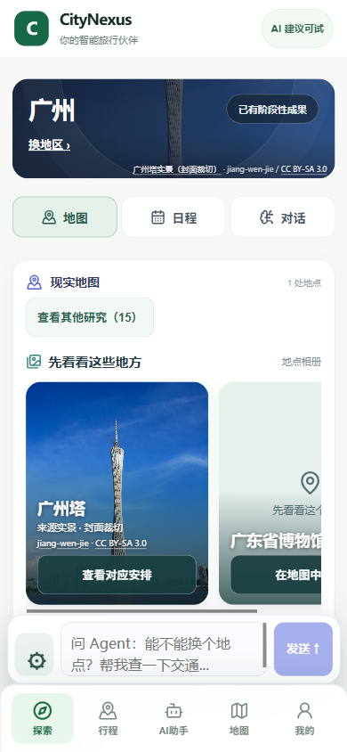

# 任意城市地点照片：产品与真实验收

产品提交：`16ab341cba1ba64e3e79781e1751833e11147a8f`。消费 PR #23 评论 6268660238；媒体适配来源为 Qoder PR #35 的 `7fdf9e0963e92efdadd8227136d11fa8adc269a7`。

## 用户现在能做什么

- Agent 在现有研究任务中调用 `research_place_media`，自动给真实地点找照片；照片同时用于地点相册、目的地封面和按天草案。
- 点击相册照片进入对应日程；点击日程照片回到同一地点的地图。一个 `candidate_id` 贯穿这三处和服务端工具步骤。
- 默认展示有照片或与方案有关的地点，其他研究可展开。没有图片的地点保留插画、地图入口和安排能力。
- 手机保留地图／日程／对话切换与唯一底部聊天框，桌面保留工作区。

## 签名与来源接线

新读取接口：`GET /api/v1/journeys/{journey_id}/agent/goal-tasks/{task_id}/place-media?candidate_id=...`。

服务端从签名本人任务的真实 source lead 取得名称、坐标和来源对象；不把 `photon:W/...` 或 `amap:...` 当作 canonical Place 主键。使用 OSM 对象自带的 Wikidata ID，或精确名称加来源坐标匹配；GCJ02 先转换 WGS84。旧的无签名 Qoder 路由没有接入。

媒体只读 Commons 原件与许可元数据；图片、作者、许可证、原件链接齐备才展示。客户端串行限量读取、取消旧身份/旧任务请求；服务端按 owner/Journey/task/source 指纹缓存，正结果一小时、负结果十分钟。OpenAPI 与生成客户端只纳入本接口增量。

## 真实广州闭环

在原隔离库，通过 Chrome-use 的原生填表与 Enter/Space 操作新建广州一天行程，批准一次在线研究和模型预算：

`一句目标 → 高德查广州塔/广东省博物馆 → Agent 取图 → 三份备选与可编辑草案 → 同任务修改下午 → 刷新恢复`。

| 项目 | 实际结果 |
| --- | --- |
| Journey / GoalTask | `f97d2dbf-921c-4942-b29b-7765ccb52e5d` / `73a7efa7-0fb0-4e2a-bf8f-3001a3865600` |
| 广州塔 | `amap:B00140WBI1`；运行时 `REAL_POI_PHOTO`，`BOUND_SOURCE_COORDINATE_MATCH`；浏览器图片 naturalWidth 536 |
| 图片署名 | jiang-wen-jie，CC BY-SA 3.0；[Commons 原件](https://commons.wikimedia.org/wiki/File:%E5%B9%BF%E5%B7%9E%E5%A1%94Scenery_in_Guangzhou,_China_-_panoramio_(9).jpg) |
| 广东省博物馆 | `amap:B00140U6L3`；`NO_PERMISSION`，显示地点插画，仍可选入方案 |
| Agent 工具 | discover_places 两次、research_place_media 两次、save_draft_itinerary、save_draft_variants；续聊 replace_draft_slots 一次 |
| 同任务续聊 | 草案 1→2；只改下午；其他时段与三个备选逐字不变；当时 ProviderCall 86→86 |
| 刷新与最终提交读回 | 四档宽度均恢复同 task_id、第 2 版、三备选；最终提交重启后任务 GET 200、照片 GET 200/cache_hit=true |

首次取图共涉及四个不同地点（含搜索返回的停车场/地铁站）；超过十分钟后的截图刷新另产生两条负缓存到期读取，没有重新发起地点搜索或模型运行。具体时间、结果、源指纹与局部修改摘要见 [JSON 回执](20261019_SOURCE_MEDIA_LIVE_RECEIPT.json)。

连城原有三张 curated 来源照片保留并实际加载（naturalWidth 均为 960），用“最近的行程”打开原任务复核。它们仍标为历史来源照片；广州塔照片来自本轮通用运行时接口。

## 界面与回归

- 安装版 Chrome：390×844、430×932、1366×980、1566×980；无整页横向溢出。照片／日程同地点回跳已操作。
- 最终后端聚焦测试 **20/20**；独立 SQLite，不使用用户数据库。
- 最终串行 headed Chrome 界面夹具 **45/45**；TypeScript、Vite build、diff-check 通过。
- 真实模型任务为签名 **DRAFT / PARTIAL_READY**。营业、费用与转场未另行核实；模型文案里的“免费”等仍是待核实建议，结构化费用状态保持 UNKNOWN。本轮不包含正式 ACTIVE 出发验证。
- 截图为实际 Chrome 视口。用户本人手机触控验收：**PENDING**。

### 实际画面

[430日程与备选](assets/20261019-source-media-guangzhou-430-timeline.png) · [390日程照片和修改](assets/20261019-source-media-guangzhou-390-day-detail.png) · [1366桌面](assets/20261019-source-media-guangzhou-1366-map.png) · [1566桌面](assets/20261019-source-media-guangzhou-1566-map.png) · [连城390](assets/20261019-source-media-liancheng-390-map.png)

试玩仍为原隔离服务：`http://127.0.0.1:14332/revolution`；最终产品提交已重启，保留原 DB 与认证密钥。打开“最近的行程”可在广州和连城之间切换。
