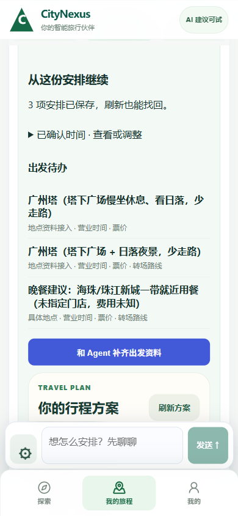
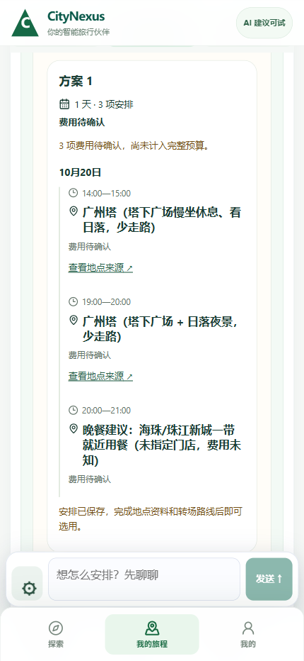

# V3 已选草案 → 首份候选：实测增量

现在可在「我的旅程 → 准备出发」确认现有草案的时间，保存首份正式候选并刷新找回；真实出发仍缺地点资料与转场证据。

## 本轮消费的新指示

- Issue #42 评论 6284670660（2026-10-20 06:12:53 UTC）。实读 PR #23 / PR #35 的当前代码；没有重做素材导入或另开 UI 项目。
- PR #35 来源 c1f4b3a9d0 的 from-slots 要求 canonical Place，null base 规则不能用于首趟 DRAFT。此问题仍在上游；没有宣称修掉了 Qoder 的原接口。
- 本分支新增 task-aware 签名适配器 `POST /journeys/{jid}/agent/goal-tasks/{tid}/prepare-plan`。它直接读同一任务的当前已选草案，只接受 revision 和本人确认的逐项时间，不接受客户端提供地点名、来源 URL、价格或状态。

## 实际产品

1. 原日期、活动次序、标题、来源 candidate ID、备注留在原 Journey，时间由界面确认。没有再开第二套找地点表单。
2. 本人权限、草案 revision、完整 slot 覆盖、重叠/旅行窗口检查；Idempotency-Key 重放返回同一候选。
3. 生成既有 PlanVersion/Activity 模型中的 CANDIDATE。草案仍可继续讨论和修改；选用与正式开始仍分开。
4. 已存在的正式地点按同城市 + 精确 provider/external_id 绑定。未匹配的来源保留在活动 metadata，place_id 为空，保留待办；不按名称猜映射，不新建 Place，不把来源线索改成已核实事实。
5. 费用未知保持 UNKNOWN，不将兼容整数 0 显示成免费。真实免费需要已有明确费用证据。
6. 确认时间与候选 ID 存回同一任务，刷新恢复；保存后折叠时间表，待办按活动合并，手机保留一个 Agent 输入和三个底栏入口。

## 真实 Chrome 操作（无 API mock）

- 后端代码 d796a731e09132d8bfc654040edc3651d5d8fb09；最终手机 UI b81fe06212f723e406cde459cd8562789cc80540（后续 UI 提交未改后端）。
- 原隔离试用库、原认证密钥、原广州 Journey 与 GoalTask，未创建 ACTIVE 或清空数据。
- chrome-use 原生 focus/Enter 进入「我的旅程」。按原旅行窗口，把晚餐调整到 20:00–21:00，勾选时间后 focus/Enter 保存。
- 真实 POST HTTP **201**，首次创建候选 `54d2cfca-ad1f-4dd5-a198-128c21a1294c`，3 项活动，草案 revision **2**。
- 原日程保留：14:00–15:00 / 19:00–20:00 / 20:00–21:00。真实 reload 后候选 ID、三项时间、任务 revision 均一致。
- GET Journey / GoalTask / plans / departure 均 **200**。Journey 仍 DRAFT；候选 selectable=false、费用 PARTIAL_UNKNOWN。未调用 select/start，没有新模型、地点搜索或付款请求。
- 返回 11 个逐字段缺口，手机合并成 3 项活动待办：两项广州塔安排缺正式地点绑定/营业/费用；晚餐还没有具体店铺；转场尚未确认。
- 390×844 / 430×932 是安装版 Chrome 的 CSS 视口；均无横向溢出、3 个导航、1 个输入。截图不是手机硬件验收。截图框定使用 CDP，真实写入使用 chrome-use 原生焦点/Enter。

[真实 HTTP 与刷新回执](20261020_DRAFT_PREPARATION_LIVE.json)

## 验证

- 隔离 SQLite：`test_goal_preparation.py`、`test_qoder_departure_read_r1.py`、`test_goal_task_routes.py` 共 **27/27**。
- d796 手机/桌面安装版 Chrome 界面 fixture 全组 **50/50**。首次回归发现无草案时空对象访问，修复后整组重跑通过。
- b81 合并待办/折叠时间表后，新流程 390/430 定向 **2/2**。
- 最终 TypeScript / Vite build / git diff --check 通过。fixture 数据只用于自动化测试，真实 Chrome 操作使用原签名广州任务。
- GitHub CI 随最终 push 查询，不能用上一版的通过代替最终 SHA。

## 当前完成值

| 项目 | 实际值 |
| --- | --- |
| USER_VISIBLE_BUTTON | 保存为正式候选方案；真实点击 HTTP201 |
| FIRST_DRAFT_TO_CANDIDATE | PASS：原本无正式 PlanVersion 的 DRAFT 创建第一份候选 |
| SAME_JOURNEY | PASS：原广州 Journey / GoalTask / revision2 |
| SOURCE_TO_PLACE | 既有精确来源匹配有 fixture；本次广州未找到正式 Place，仍待补齐 |
| COMMIT_RESULT | 未执行；候选尚缺正式地点、营业/费用与转场资料 |
| GUARDIAN_CONSENT | 既有读取/权限 fixture 保持通过；本轮未新做真实 ACTIVE 或 2/3→3/3 连续验收 |
| USER_VERIFIED | PENDING |

下一段实际产品缺口：让 Agent 通过已有来源采集/身份合同补齐上述地点，随后冻结真实转场证据，再走本人选用与启动。当前候选是可恢复的出发准备成果，不是已通过的真实出发计划。
