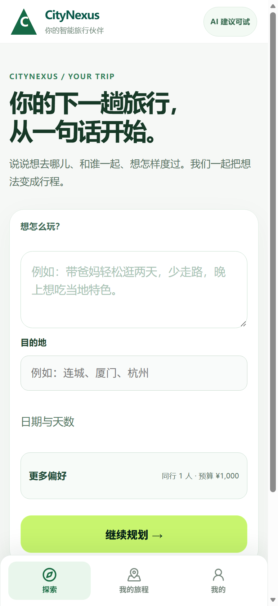
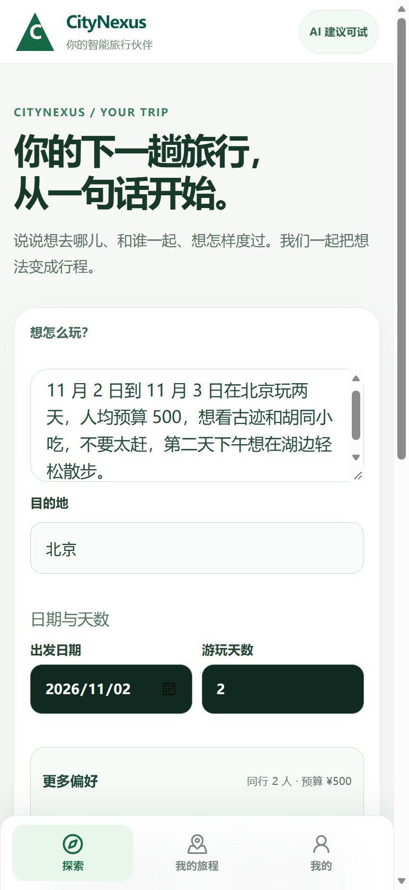
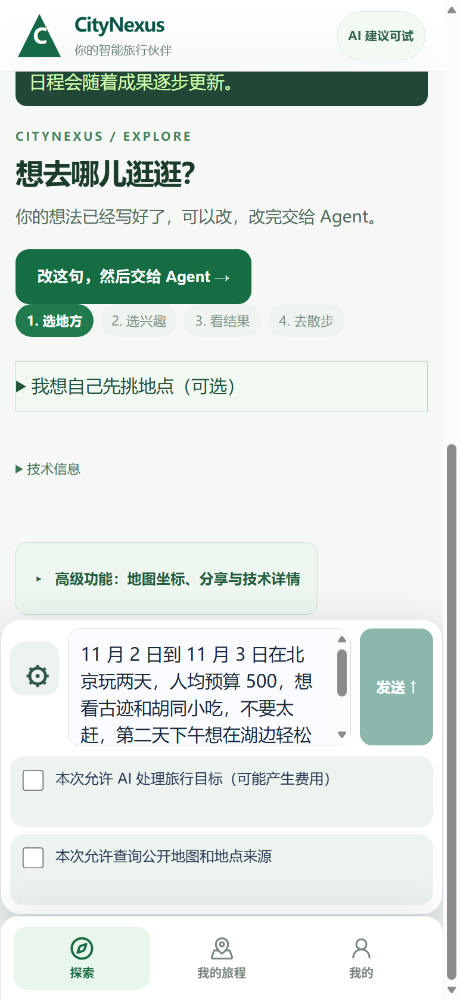
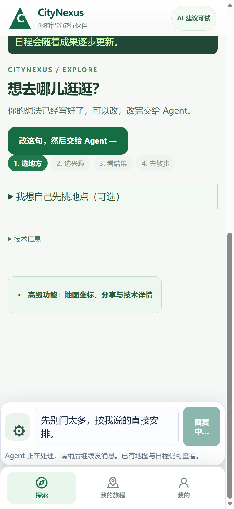
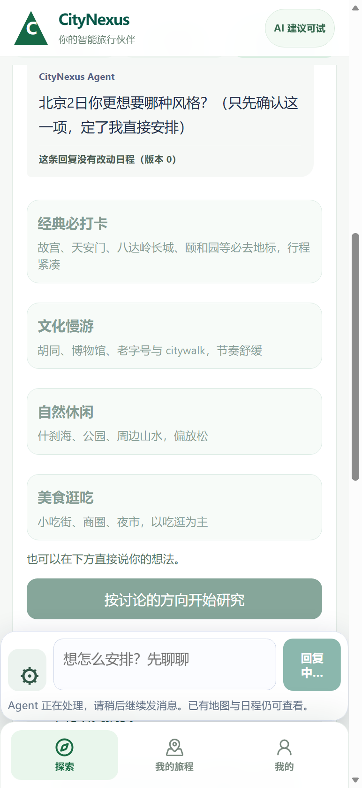
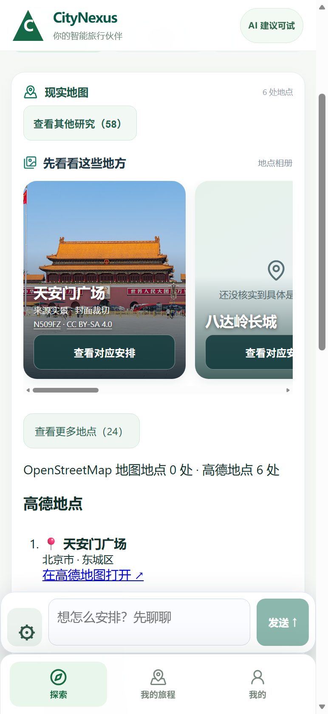
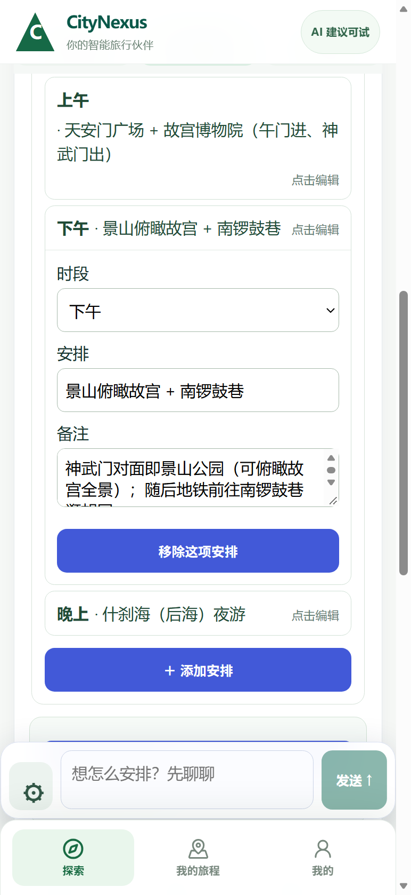
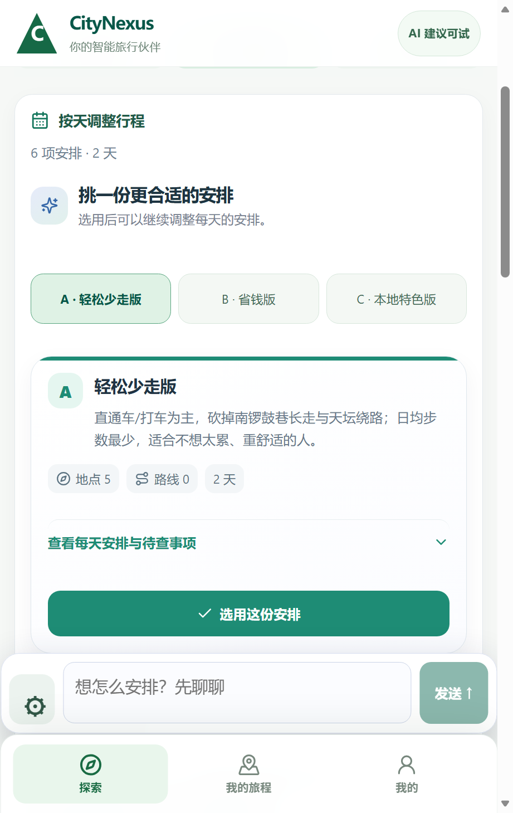
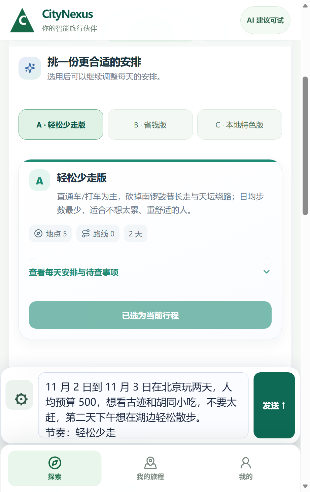
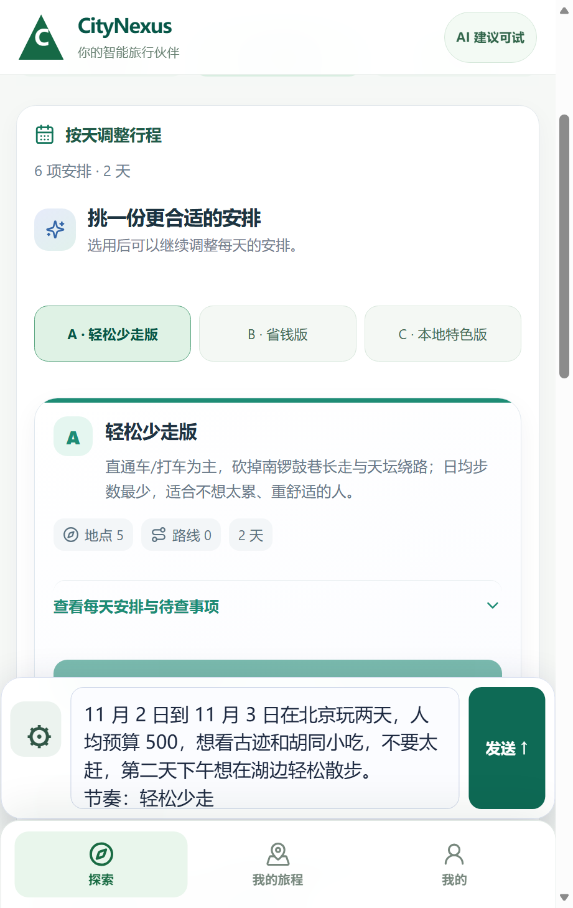

> **时效标注（2026-10-25）：** 这一页写的是十月的旧版界面与旧启动链，部分交互（A/B/C 三版、点击编辑）在当前树上已不同。当前这棵树上重走的一键试玩在 `20261025_V3_PLAY_QUICKSTART.md`，启动器与真检索的实测读数在该页引用的证据里。

# CityNexus 十步试玩说明（给第一次打开的人）

廿二日深夜到廿三日凌晨，这十步在**真实桌面浏览器的手机视口**里原样走了一遍（Windows 上一枚真实可见的 Edge 窗口、视口 414×900、隔离测试账号）。**不是物理手机硬件**——手指在真机屏幕上的手感、手机浏览器的行为，这一版没有验过。每一步配的那张图就是那一步按下去之后屏上的样子，图名可以在 `20261022_v3_human_chrome/` 里翻到；引号里的字都是从屏上读回来的，不是设计稿。

**1. 打开 App，只看到一句话的入口。**
「你的下一趟旅行，从一句话开始。」

**2. 在第一格写人话，第二格写城市。**
例如「11 月 2 日到 11 月 3 日在北京玩两天，人均预算 500，想看古迹和胡同小吃，不要太赶」。想指定日子就点开「日期与天数」，想改人数预算就点开「更多偏好」——这台机上填进去回读的是「2 天 · 2 人 · ¥500」。

**3. 按「继续规划 →」。**
屏幕下方那行就是你刚说的话，想改点进去改，不用重填。

**4. 第一次用要先勾两行「本次允许」。**
不勾的话「发送 ↑」不会亮——勾完它就亮了。

**5. 按「发送 ↑」，Agent 会先问你。**
它给选项时按选项回答，不用打字（这台机上第一题给了四个选项，第一个是「经典必打卡」）。

**6. 不想被继续问，就说「按讨论的方向开始研究」。**
研究完，切到「地图」那页，下面「先看看这些地方」会出现带署名的实景照片（这台机上第一格是「天安门广场 来源实景 · 封面裁切 N509FZ · CC BY-SA 4.0」）。

**7. 没图的格子，点里面的「先看看这个地点」才会去找。**
找到就换成真图；找不到会直接告诉你为什么——「还没核实到具体是哪个地点」或「没查到可核实的实景照片」，不会拿别的地方的图凑。

**8. 想改哪半天，直接说；要改得细，点那格「点击编辑」。**
时段、安排、备注都能改，改完「添加安排 / 移除这项安排」也在同一格里。
（上图那格展开的就是编辑器。）

**9. 想几版对比着挑，就说「按轻松少走、省钱、本地特色各出一版，让我三选一」。**
切到「日程」，上面出现 A / B / C 三个标签和一张卡，卡上写着这版的花费思路与「地点 5 · 路线 0 · 2 天」，按下「✓ 选用这份安排」，日程就换成那一版。

按下之后，那张卡的按钮变成「已选为当前行程」，下面那行也带上你选的节奏：

**10. 刷新之后，选过的那版还在。**
刷新后屏上仍是「6 项安排 · 2 天」，那张卡上的按钮变成「已选为当前行程」。要继续往下走，「准备出发 · 正式计划与待办」在底部「我的旅程」里；同一屏还能按「行程守护」——没有真实风险时它只说「还没有检查记录」，不会编事件。
**这一条只验到"刷新"，没有验到"换一次登录"。** 关掉浏览器再打开，暂时不能保证找回这趟行程：这枚壳的登录凭证放在标签页自己的会话里，关掉就没了，而"重新认证后把有权访问的旧行程读回来"那扇门还没建（成因与两条待裁路径记在走查稿第十一、十五节）。

---

**两处要提前知道的实话。**

- 照片能不能出现，取决于这台设备能不能连到维基共享资源。这次是在隔离测试栈上给它单独开了一条出口，不是产品默认；连不上时格子会保持中性占位，不会配假图。
- 关掉浏览器重开（新标签页）会找不到旧行程，因为登录凭证只存在这一页会话里；屏上现在会写「这台设备上还留着『北京』这趟行程，这次打开没有登录到它」。凭证过期时也一样说实话：「这次登录已经过期，这趟行程还在，只是这台设备当前读不到它。」怎么"读得回来"还在等一条裁语。
