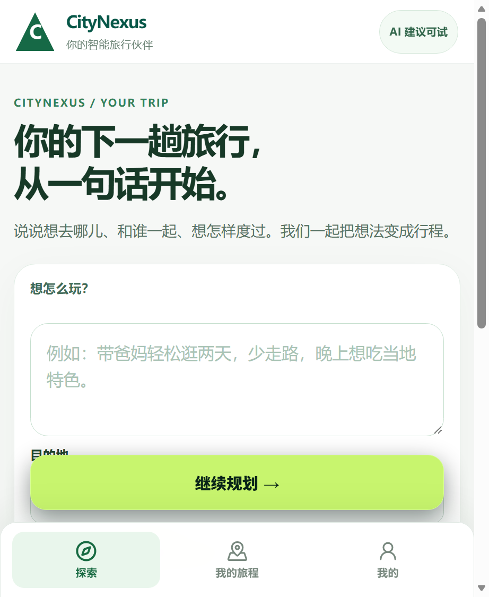
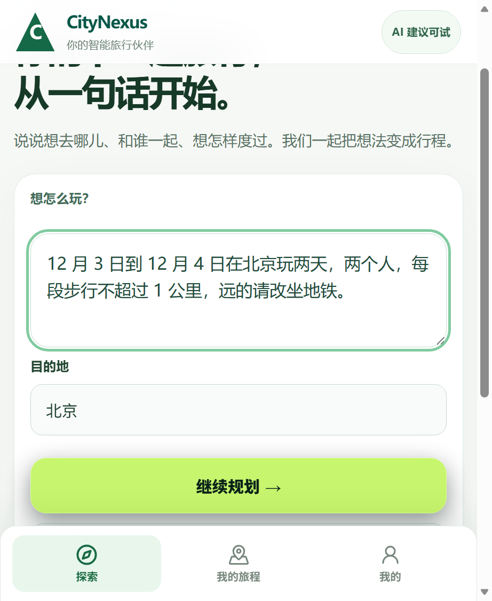
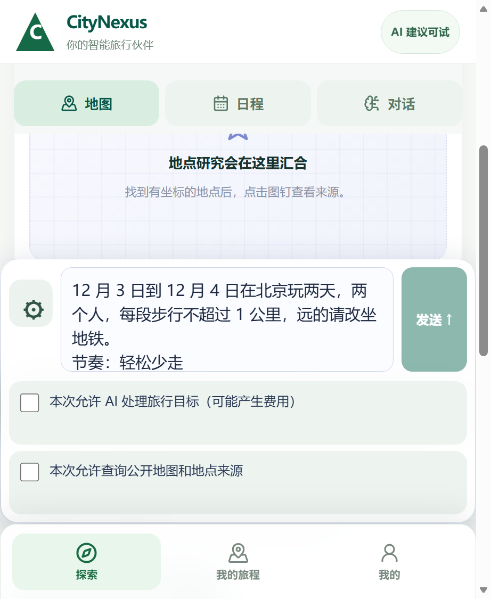
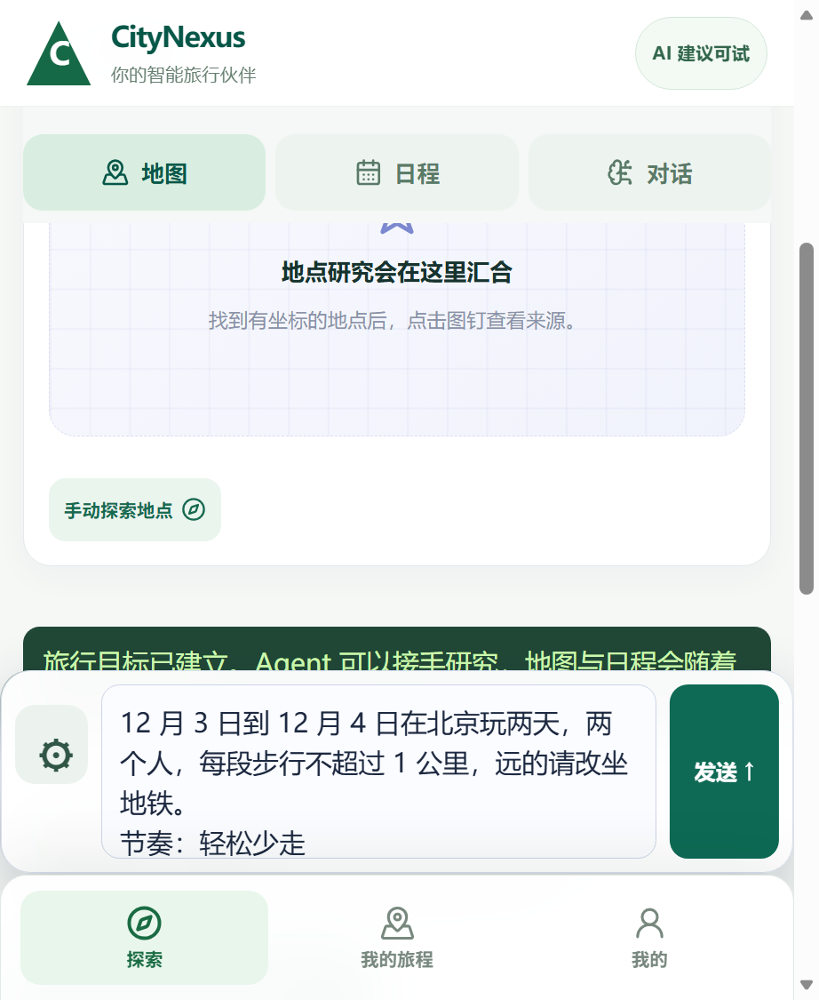
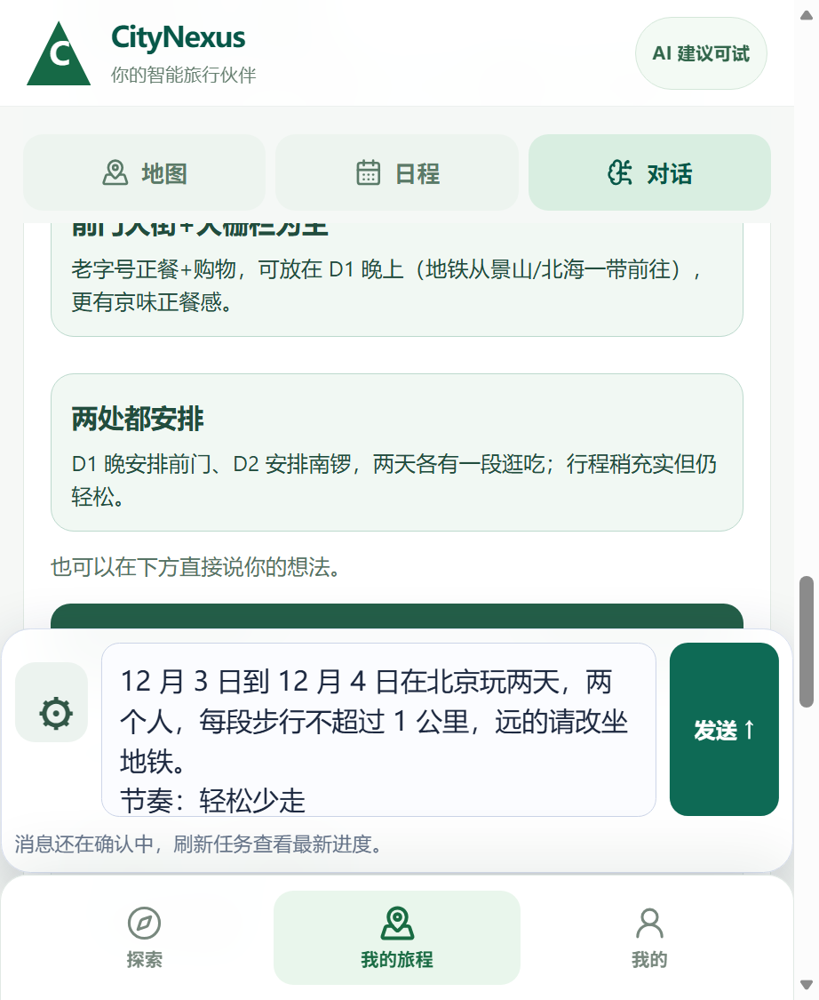
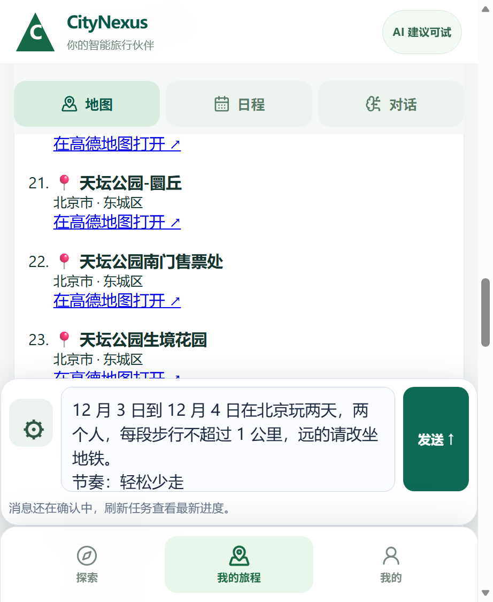
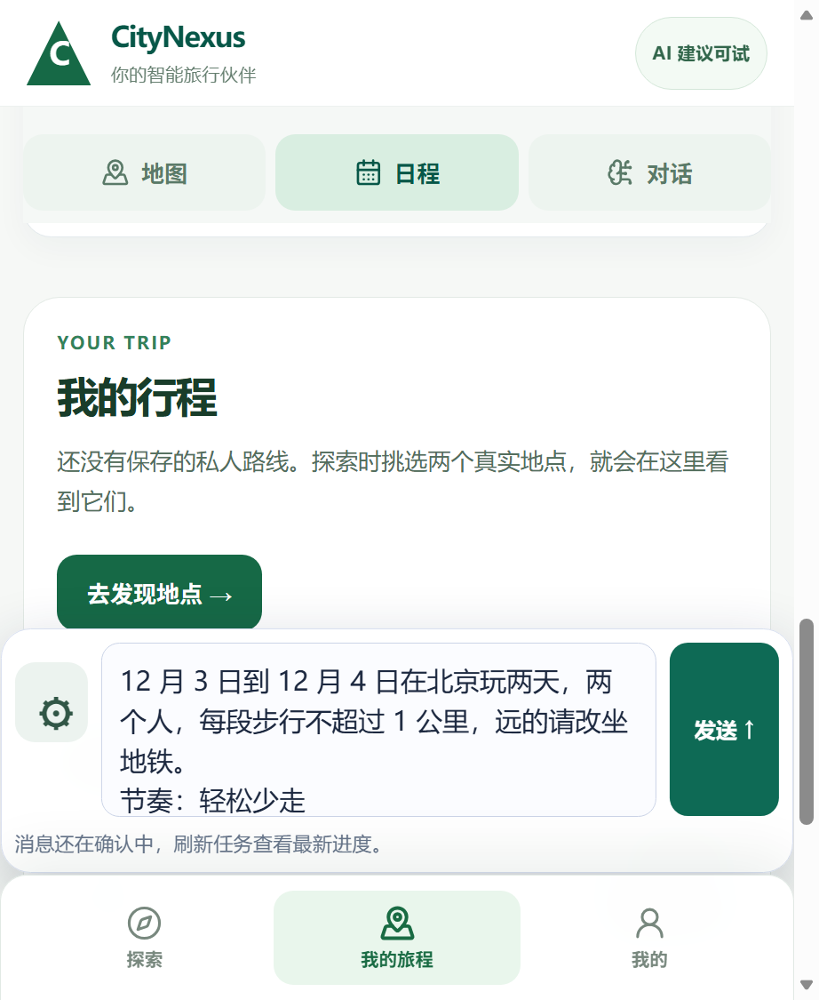

# CityNexus 一键试玩（八步 · Windows 本机 · 2026-10-25 夜实测）

这一页是在当前这棵树上重新走出来的，**不是旧版十步单页的复制**。启动器的两处交付缺陷在今晚修好并实测：一是启动脚本原先指向一份没有开真检索的旧服务副本，二是它把「端口有人在听」误判成「不是我起的」而在就绪判定上干等（详见 `20261022_V3_CHROME_USE_HUMAN_WALKTHROUGH.md` 第五十八、六十节）。现在双击后预检会自己说「检索已开」，并在四十秒左右写出就绪文件。

**实测读数（都可外读）：** 预检与等待腿通过、打印本机地址与「三步玩法」（`20261022_v3_human_chrome/play-preflight-1.txt:2`）；就绪文件写 `real_city: "live"`、`web_bind: "0.0.0.0"`（`20261022_v3_human_chrome/play-ready-1.txt:1`）；后端 `/providers/v9` 对高德答 `READY / LIVE`（`20261022_v3_human_chrome/play-providers-1.txt:1`）。

## 怎么开

1. 双击 `trial/play_launcher/citynexus-play.bat`（本机玩）。平板同一 WiFi 要打开时，双击 `citynexus-play-lan.bat`；预检会把平板地址打出来，并说明防火墙那条命令要你自己决定。
2. **那个黑色窗口不要关**，它就是服务。窗口里跑完预检会打印本机地址：`http://127.0.0.1:14461/revolution`。
3. 想停：关掉黑色窗口（或里面按 Ctrl+C）。行程数据留在 `D:\moodle\_cmdr_v3_live_1022\citynexus_v3_play_1024.db`，下次双击还能接着看。

## 八步

**1. 打开就是一句话的入口。** 屏上写「你的下一趟旅行，从一句话开始」，下面一个目标框、目的地框与「继续规划 →」。

**2. 写一句人话，写城市，再把「日期与天数」打开设成同一组日期。** 这台机上填的是「12 月 3 日到 12 月 4 日在北京玩两天，两个人，每段步行不超过 1 公里，远的请改坐地铁。」目的地填「北京」。**日期必须在「日期与天数」里也选成 12 月 3–4**：只在话里写日期而首屏仍留着默认日期，Agent 会一次次问「哪组日期是对的」，研究跑完也出不了正式方案（详见 `20261022_V3_CHROME_USE_HUMAN_WALKTHROUGH.md` 第六十二节）。

**3. 按「继续规划 →」。** 进入你的旅行搭档屏：上面是「地图 / 日程 / 对话」三层，下面是固定输入框。你刚说的话已经写进输入框。

**4. 第一次用，勾两行「本次允许」。** 一行允许 AI 处理旅行目标，一行允许查公开地图与地点来源；勾完「发送 ↑」才亮。这张图就是勾完的样子。

**5. 按「发送 ↑」，让 Agent 先问。** 它会先给你几个方向（这台机上给了三张卡：经典三选、跳过景山等），底部有一个「按讨论的方向开始研究」。想被继续问就点卡片；不想被问就按那个按钮。

**6. 研究时，三层都能翻。** 点「地图」能看到真实地点与「在高德地图打开 ↗」的链接（这台机上列到 24 处，含天坛公园）。这不是示意图；后端对高德的状态是 `LIVE`。

**7. 点「日程」看它整理出的安排。** 研究还在跑时，这一页会如实写「消息还在确认中，刷新任务查看最新进度」，不会假装已经排好；上面的「我的行程」也会说还没有保存的私人路线。

**8. 等它跑完，再进「准备出发」。** 跑完后，「准备出发 · 正式计划与待办」里会出现正式候选方案与「选用这份方案」；按下之后按钮会变成已选，日程按那一版走。

**这一格本轮走到了哪（如实写）。** 从按「按讨论的方向开始研究」起，这台机器上研究真的跑了：服务端记下 **45 条事件、8 次工具结果、16 处已核对的正式地点**（`20261022_v3_human_chrome/play-v3-research-1.txt:22`）。但因为它一直没把两组日期合成一组，最后停在「先不动，你再去核对哪组日期是对的，我暂停研究」，正式候选方案没有出现。所以第 8 步只有文字，没有「方案已出」的截图——**我没有把未完成的那一步拍成完成**。按第 2 步把日期设成一致，是下一次要验证的路径。

## 这一页证的与没证的

- 证的：启动器能起来、真检索开着、首屏到「Agent 先问」的六步都在真栈上真点过（指针点击，坐标来自渲染盒），地图里的地点与高德链接是真来源。
- 没证的：物理手机上的手感与浏览器行为（这一轮是 Windows 上的桌面 Edge 窗口，视口 495×604）；研究跑完后「选用方案」那一步（本轮没跑到）；主人自己按一遍仍算 `USER_VERIFIED = PENDING`。
