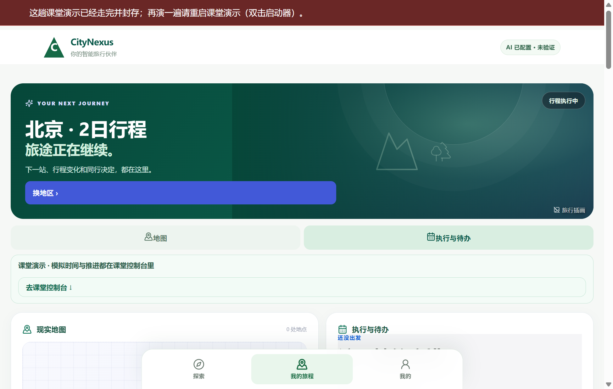
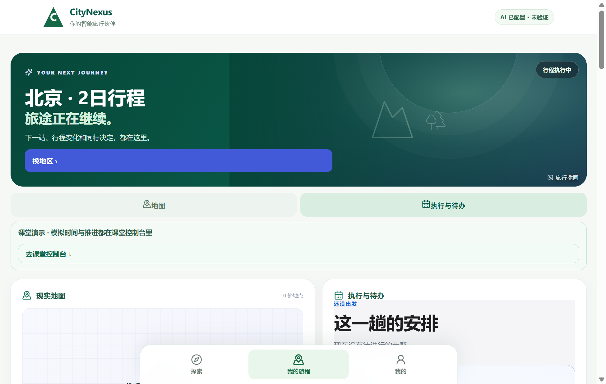
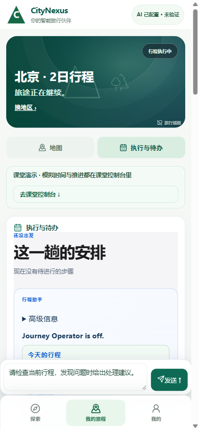

# Completed-trip entry: Suzhou pairing leaves an old Beijing workspace visible

Observed in real Chrome on root's existing owned 14522/60622 stack: frontend `2176c811a81428f07e0ef50eb3079e6d9f284cef` plus previously recorded foreign UI dirty files, backend product `e2c893a0115d381abe83e781c448766a1c148b78`. This is independent root visual evidence, not Qoder's integrated classroom or a user-operated physical device.

1. Opening `/revolution` and clicking **我的旅程** showed an unauthenticated local hint for the old Beijing trip. This correctly did not establish access to its progress.
2. An authorized native one-time ticket was issued specifically for Suzhou Journey `e7f868e4-2d03-4d3c-b563-962e47b185f4`; the persisted ticket row proves that exact binding and successful consumption. No token/ticket secret is included in these files.
3. Without a post-redemption reload, the browser showed **这趟课堂演示已经走完并封存** while still rendering **北京 · 2日行程 / 旅途正在继续 / 行程执行中** behind it. Server reads show both the requested Suzhou Journey and that old Beijing Journey are COMPLETED. Both belong to the same actor; this is a target/status restoration defect, not evidence of cross-user disclosure.
4. A normal reload removed the sealed-trip alert but retained the old Beijing workspace and ongoing-trip hero. The requested Suzhou four-stop run was not reached through this entry. Resizing to 390×844 confirmed the same misleading old-trip hero visually.

Expected: redeeming a Journey-bound ticket should show the intended Journey, or clearly stop on that Journey's completed summary. It should not leave a different locally cached Journey presented as ongoing. Reload should retain the correct target and server terminal state, with a path to review the completed run.

Static corroboration, not a UI patch: `RevolutionFirstLook.tsx` stores the new traveler identity, then returns on a COMPLETED Journey before `resumeSavedTrip(journeyId)`; its local Journey object is not cleared in that branch. The initial legacy-restore effect can skip the server refresh when the pointer owner matches the paired identity. This is consistent with the observed stale workspace; Qoder should verify and fix the entry/restore logic in its owned frontend.

Actual screen evidence (the first two are desktop; the third is a separate 390×844 read, not a four-stop mobile acceptance):

`20261026_COMPLETED_ENTRY_VISUAL/receipt.json` records target/server IDs, ticket consumption metadata, exact image dimensions/hashes and limits; `after-refresh-ax.txt` contains the scoped accessibility read. Two QA-only pairing tickets were used in total: the existing helper's post-redemption reload exposed the problem, then one guarded no-reload reproduction distinguished the initial screen from refresh. No additional ticket is issued by replaying the guard.

AgentRun remains 40 and ProviderCall 117. No model, POI or route request was repeated; no new run, event, proposal acceptance or advancement occurred. No Qoder UI/launcher/database was edited. The backend 2/0 + 2/0 signed-progress acceptance remains valid, but this browser entry blocked visual access to that Suzhou result. Handoff is for Qoder's already assigned cold-entry/map integration work; do not replace the database or reset a completed Journey to make the screenshot pass.
