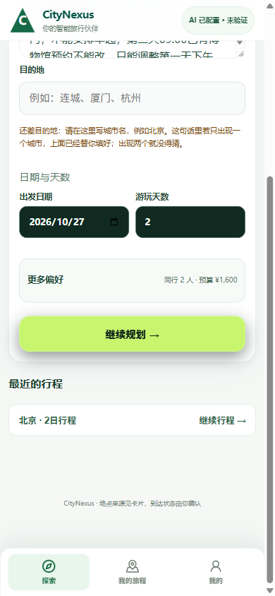
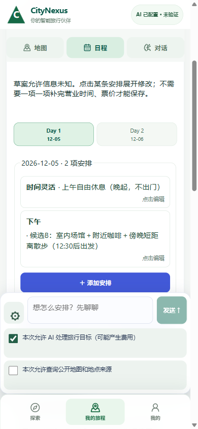
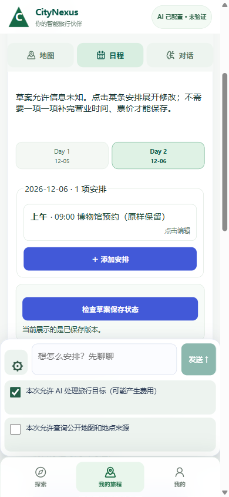
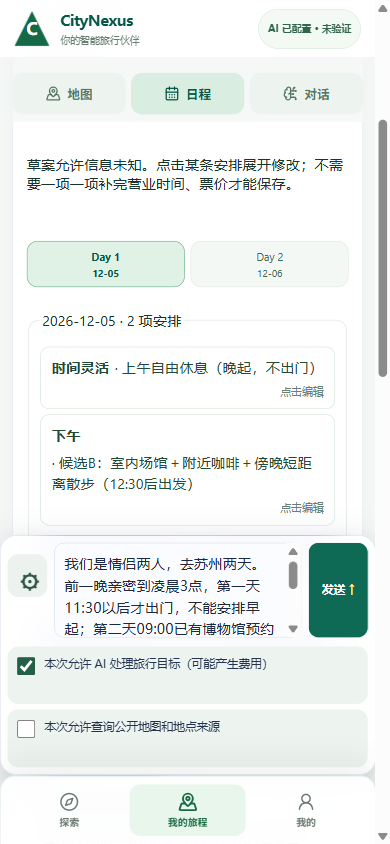

# 情侣晚起、总预算否定句与只改半天：实际 Chrome 三轮

实际在既有 own Chrome / 14522→60622 操作；后端产品 `e2c893a0115d381abe83e781c448766a1c148b78`。Qoder 前端从 `ab2ca591` 变化到导出时 `6425e142`，入口文件仍 dirty；这是混合栈实测，不是一份冻结前端或正式课堂部署验收。

- 输入情侣两人、前晚亲密至凌晨3点、Day1不早于11:30、Day2已有09:00博物馆预约且只能改Day1下午、两人总共800元而非每人800、不代购票。入口错误自动填成1600；先截图，再手动改回800。当前定位 `RevolutionFirstLook.tsx:484` 的 `readPerPersonBudgetFromGoal` 命中否定的“每人800”，`:534` 再乘人数；Codex没有改Qoder UI。
- 最初本人会话GET401，实际点“用新行程继续”产生另一个签名游客身份；这是新用户分支，不是旧身份恢复成功。旧记录保留。
- 新 Journey `dd5f4651-e5f7-424b-b0de-d20adeb26c96` / GoalTask `9d3beff5-3c34-422d-ab6c-c23f5f78e229`；12/05–12/06，预算80000分。仅同意AI，地图/地点来源同意始终false。
- 第一轮Agent PARTIAL并提问，曾建议把园林放Day2；第二轮明确反驳，只要Day1下午三个方向且不联网、不编票价营业；第三轮选B并要求Day2所有条目/顺序/时间/备注逐字不改。
- 三个真实AgentRun依次 `3dd9b720…` PARTIAL、`2f6b9c84…` COMPLETED、`2a40069d…` COMPLETED；最终使用 `replace_draft_slots`。任务记录10模型回合/8工具，不把3个AgentRun说成3个上游物理请求，也不猜供应商实际模型。
- 草稿rev1→rev2：Day1上午原样休息；下午A/B/C收为一个B“室内场馆＋附近咖啡＋傍晚短距离散步”，机器约束 `date_constraints[2026-12-05].afternoon.start_not_before=12:30`。
- Day2整段JSON深相等，规范SHA256前后都是 `9fbd27f73ce171389e9fa94c3c3f76218920994f7200f82adf5650c8b96eb5e8`。上午休息槽也深相等。
- 最终Journey DRAFT、Task PARTIAL_READY、正式PlanVersion0、SimulationRun0；所有槽place_id=null，营业/票价/转场UNKNOWN。09:00预约只是用户陈述的占位，不是已核实预约。没有购票、ACTIVE、四站或实体设备验收。
- Agent40→43，ProviderCall117→117；导出阶段只读当前具名Journey/task/Agent记录，浏览器只切Day1/Day2，没有再发模型或研究请求。

原图与安全投影：[receipt.json](20261026_COUPLE_LATE_START_UI/receipt.json)。不含bearer、票据、模型私密prompt、工具原始参数/结果。QA导出器保留在隔离QA目录并有防覆盖断言；原DB备份未入仓。

下一步交Qoder修入口预算否定/明确总额优先级，并保留真正人均预算的正例；不抢其热文件。继续更刁钻场景时保留本任务与已完成模型结果，不重放请求来凑绿。

原生刷新增量：同页面reload后仍显示苏州Day1休息+B、Day2页签及联网未勾选；当前具名task草稿JSON逐值不变，Agent43/Provider117未增。但刷新前空输入框/禁用发送，刷新后回填已经发送过的最初整段目标＋节奏且发送可点，见[刷新收据](20261026_COUPLE_LATE_START_UI/reload-receipt.json)与[原生AX](20261026_COUPLE_LATE_START_UI/reload-ax.txt)。未点发送，不能声称已实际重复请求；这是待Qoder处理的陈旧输入恢复风险，不是草稿丢失。

