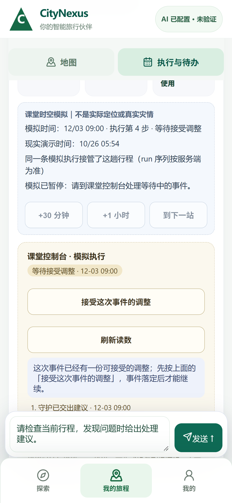
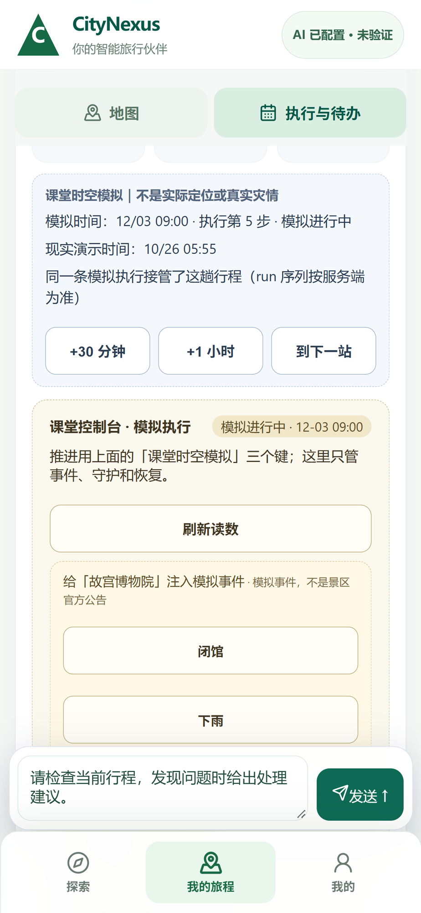
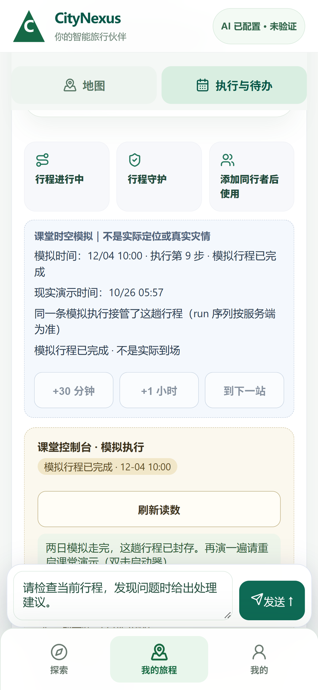

# 课堂演示：当前事件调整、接受和继续

## 本次实际结果

在隔离课堂副本里，用 Chrome-use 的 390×844 手机视口完成了同一场演示：触发故宫关闭事件 → 真实模型调用工具 → 生成绑定本事件的新方案 → 签名旅客点击接受 → 继续模拟 → 跨天到天坛 → 完成 → 刷新恢复。正常停止并重启自己的服务后，同一 run 仍为第 9 步 `SIMULATED_COMPLETED`，没有重放模型调用。

- 后端产品版本：`29dafc1efde3ad52a256bf4eb5847ec40a70076a`。
- 前端：Qoder checkout 的 `f64fd0fb184f44c08a98eb60d3ec9ab79c12ec9a` 加其现有未提交修改。本报告不把该界面归为一个干净前端 SHA。
- 页面：`http://127.0.0.1:14522/revolution`；后端 60622；复用原课堂副本数据库和认证。
- Chrome 实测 CSS 视口 390×844、触摸启用；操作使用原生触摸事件。输入中继的坐标缩放经命中点核对后校准，没有调用应用点击处理器或写接口代替点按。尚未由实体手机验收。
- 证据明细：[JSON](20261026_GUARDIAN_LIVE_CHAIN.json)。

## 真实模型与工具

`auto:cheapest` 应走本机现有 7865 路由器；最初误发原始 7863 端口的请求返回 HTTP 400，此失败仍保留。只调整了本次隔离启动进程环境，没有修改全局网关配置。正确路由后的 Agent 执行了 10 个工具步骤，包括读取行程、读取数字孪生、查找调整方案、查城市服务、生成当前事件的调整方案，以及来源与费用补证工具。具体上游模型没有返回，因此不猜测模型名称。

模型第一次查错旧事件被拒绝，下一步改为正确查询。生成多地点方案时，它只给了一个地点，工具返回 422；另一次来源查询返回 `SOURCE_DISCOVERY_UNAVAILABLE`。Agent 达到本轮 10 步预算后为 `PARTIAL`，但已持久化的当前事件新方案可接受。本报告不将其写成 Agent 全部任务完成，也不把估计值改写为核实事实。

## 同一场的持久化链

- Journey：`2e9cd67d-10ca-4ecd-920b-76c81a350c71`
- SimulationRun：`5625ed72-9aff-4c87-8bb3-68d9291775e1`
- 当前关闭事件：`7cf6f587-cec6-4c30-823a-b7cab6891c6f`
- Guardian：`5a31ffd4-c771-4b36-9fbd-b78d540e20a5`
- AgentRun：`59d8ef94-976b-4ab8-a8c7-bc194c48773b`
- 新方案：`88571de6-d416-43fb-a0d6-a264db797552`，状态 `ACCEPTED`，trigger 和 source_agent_run 均与本轮匹配。
- 接受审计：`replan.accepted`，actor 为 `AUTHENTICATED_TRAVELER`。
- 新 PlanVersion：`5337ace4-4453-4ab2-ae62-7ba56567a3b3`。
- 当前 run 新完成活动只有天坛公园；天安门广场为进入本场之前已完成，不纳入本场站数。故宫已从新方案移除。

### 实际画面

当前事件新方案：



接受后继续，下一站为天坛：



正常重启后仍保留完成状态：



## 从现场错误补上的代码

`generate_plans.place_ids` 现在向模型声明至少两个互不重复、由服务端工具返回的地点 ID；`candidate_count` 明确表示备选方案数量。没有添加固定工具顺序或虚构第四个地点。

晚起与预约的对话回归经过真实 GoalTask 编排、声明式模型替身：第二天 10 点预约与 11 点后出发冲突时，模型收到具名冲突，再通过 `ask_traveler` 给出保留预约提前出发、或用户自行改约后晚出发两种选择；未改动预约。另测只改晚餐，其余日期、预约与下午活动保持。模型替身回归不代表现场模型一定会作出同样选择。

根串行命令：

```powershell
$env:PYTHONPATH='.'
$env:DATABASE_URL='sqlite:///:memory:'
& 'D:/moodle/CityNexus/backend/.venv/Scripts/python.exe' -m pytest tests/test_issue49_generate_plans_tool_schema.py tests/test_issue49_goal_followup_choices.py tests/test_issue49_goal_date_constraints.py tests/test_issue49_goal_full_save_http.py -q --junitxml='C:/Users/仓鼠王/cn51/classroom-20261026-qa/final-followup-verified.xml'
```

结果：17 passed、4 warnings、exit 0。首次回归为 15 passed / 2 failed，原因分别是测试说明字符串大小写、测试假定助理摘要必定进入会话倒数第一项；修正为检查最新用户消息及其持久化，不放松预约与其他安排的断言。没有为此修改业务行为。`29dafc1efd` 的 GitHub focused-backend run `40237035274` 为 152 passed；不与本地重叠用例相加，也不将旧 SHA CI 当作后续新提交通过。

## 接下来直接解决的体验缺口

交给 Qoder 的界面接线：

1. 当前 Presenter/助手面板没有显示这次已落库的 10 个真实工具步骤，仍有“暂无助手运行记录”。应消费同一 Guardian/AgentRun 的轨迹。
2. 接受调整后，外层行程工作台仍短暂显示故宫；刷新后才变为天坛。接受成功应刷新 Journey/PlanVersion。
3. 接受按钮旁应展示这份新方案实际增删的活动与费用变化，便于用户选择。

未完成：两天各两处具名活动、空白一句话到正式 ACTIVE 的连续验收、晚起/预约的真实模型与可见界面验收、实体手机触控验收。当前来源只有三处已映射真实 POI，第四处原为无 Place 的 FREE_TIME，路线几何仍为 0；不能拿站数标题或历史完成记录补足。
