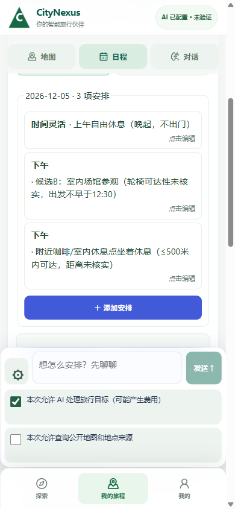
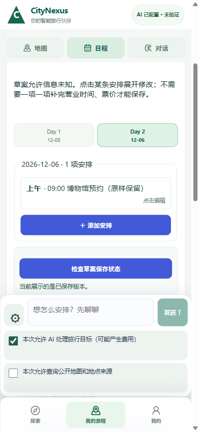

# 轮椅、每段500米与不可改预约：实际手机Chrome局部修改

在既有own栈390×844、同苏州Journey `dd5f4651-e5f7-424b-b0de-d20adeb26c96` / task `9d3beff5-3c34-422d-ab6c-c23f5f78e229`，继续测试而非另建演示。后端产品e2c893a011；前端起始HEAD `6bff969efe76171bcb473a0abdb683fe0dd4d26e`且入口dirty，版本/文件哈希见收据，不称冻结课堂部署验收。

- 实际键入：同行者手动轮椅、不能台阶、每段步行/推行≤500m、禁止抬人上下楼；只改Day1下午B为室内参观+附近坐着休息，取消傍晚散步。Day1上午与Day2全部内容逐字不改；12:30下限、两人合计800保留；不联网/不买票，电梯、入口、卫生间、距离与票价无来源写未知。
- 明确点击AI同意true，联网false，一次可见发送，无重试。新Agent `dd226bb8-cdea-4d30-9648-a0db49a02d19` hermes/auto:cheapest，16:02:27Z→16:02:58Z约31.4秒COMPLETED；真实完成inspect_journey→replace_draft_slots。任务累计模型回合10→13、工具8→10；不等同3个物理上游请求，不猜实际供应商模型。
- 草稿rev2→3，Day1上午不变，下午分成参观+坐着休息两项；Day2整段JSON深相等，前后SHA256均 `9fbd27f73ce171389e9fa94c3c3f76218920994f7200f82adf5650c8b96eb5e8`，结构化12:30约束也完全不变。无追问偏好。
- Agent43→44，Provider117→117；所有四槽place_id=null，opening/cost/travel_time仍UNKNOWN。预算80000分，Journey DRAFT、Plan0、SimulationRun0，预约仅用户陈述占位，未购票/ACTIVE/完成/实体USER_VERIFIED。
- 能力边界：`goal_draft_patch.py:498`附近slot schema仅title/time_of_day/place_id/notes、拒绝额外字段；可结构化保存start_not_before，但500m、无台阶和无障碍设施要求只记notes。`goal_artifacts.py:225`保存备注且相关事实为UNKNOWN。二牛Luna Max只读核对，根独占实屏/DB核验；无worker模型/provider/测试或改文件。
- 手机休息卡标题写“≤500米内可达，距离未核实”，仍有要求与事实混写的措辞风险；实际没有测量距离，不按“已证500m/无障碍路线”验收。后续应让来源、约束与已验证事实可清楚区分。

[安全收据](20261027_WHEELCHAIR_PARTIAL_DRAFT/receipt.json)含完整此轮用户输入、公开回复、前后草稿、步骤名/状态、计数及4张原图的尺寸/哈希；不含票据、凭据或工具原始参数/结果。原一致DB备份与一次发送guard在隔离QA目录，不入仓；不要重放此次模型请求。

